# fourth-and-rl

**NFL fourth-down decisions as a sequential decision problem: win-probability models, an exact solution of the whole game, and reinforcement learning, all set beside what coaches actually do.**

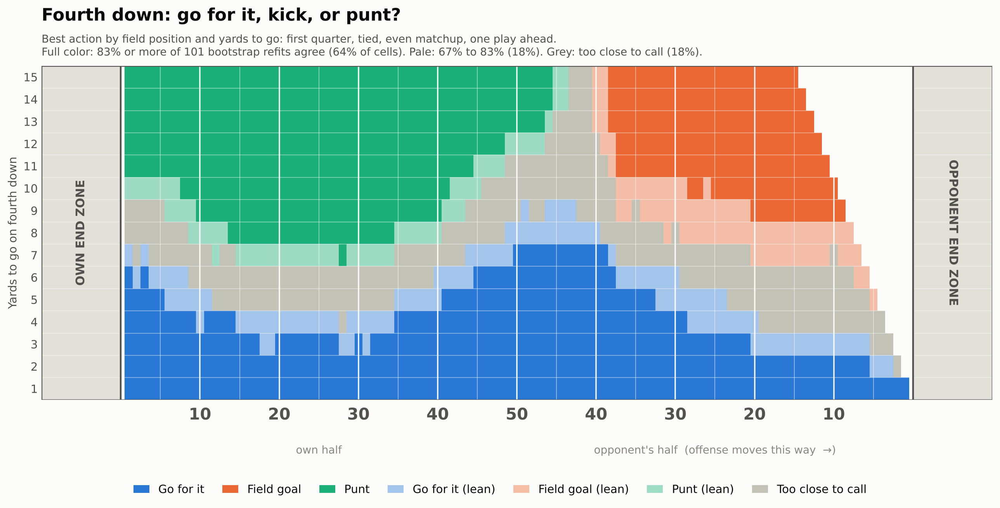

The chart applies this project's decision engine to one situation (first quarter, tied, even matchup) and shows, for every field position and distance, whether going for it, kicking a field goal or punting gives the higher win probability, in full color where at least 83% of 101 refits of the models on resampled games agree. The repository rebuilds that standard one-play-ahead analysis from public play-by-play data, solves the whole game exactly by backward induction with clock, score and timeouts, and uses that exact solution as ground truth for reinforcement-learning agents. Every number below was produced by a script in this repository and is saved under `results/`; numbers from other tools or papers are marked as theirs.

## What this project found

A *win-probability point* is one percentage point of win probability; 100 of them summed over games make one win.

1. **Protecting a late lead.** Up 4 with 4:00 left, fourth and 2 at your own 40, opponent holding 3 timeouts: in the exact solution of the game model going for it wins 77.8% against 71.4% for punting, so going is right whenever the conversion chance exceeds 38.1% (the model's is 60.3%), and the sign held in every sensitivity run (+3.1 to +10.9 points). <sub>[results/questions/q1_late_lead_dp.json](results/questions/q1_late_lead_dp.json)</sub>
2. **The one-step answer to the same question.** Looking one play ahead, the engine agrees on that play (go 74.9%, punt 70.1%, the same call in 99% of bootstrap refits) but says go in only 43% of the late-lead map against 67% for the exact solution, and real coaches leading by 1 to 8 with 1:30 to 7:00 left went for it on 2 of 55 fourth-and-2s in their own half from 2010 to 2023. <sub>[results/questions/q1_late_lead_one_step.json](results/questions/q1_late_lead_one_step.json), [results/questions/q1_late_lead_dp.json](results/questions/q1_late_lead_dp.json)</sub>
3. **Agreement with nfl4th.** On 8,426 real fourth downs of 2024 and 2025 the engine picks the same action as nfl4th 1.0.7 on 79.5% of plays and on 93.0% of those where nfl4th's own margin is 2 points or more; 79% of the disagreements are plays both tools rate within 2 points. <sub>[results/m2_nfl4th_comparison.json](results/m2_nfl4th_comparison.json)</sub>
4. **How confident the calls are.** Refitting every model on 101 resamples of whole games labels 72.3% of the 7,955 real fourth downs of 2024 and 2025 confident, 13.5% lean and 14.2% too close to call, but a simulation with known truth shows that game-bootstrap intervals for tree models cover only 77% of the time at a nominal 90%, so "confident" is overstated. <sub>[results/m3_bootstrap.json](results/m3_bootstrap.json), [results/m3b_sample_size_sim.json](results/m3b_sample_size_sim.json)</sub>
5. **Blown leads as a calibration test.** Across 4,350 games from 2010 to 2025, losing teams peaked at 95% or higher 113 to 160 times depending on the model, against 228 to 235 expected under the continuous-path formula and 154 to 168 under a simulation with realistic play-to-play jumps, so most of the shortfall is discreteness, and the exact first-crossing test finds no departure in any model that survives a correction for its 18 tests. <sub>[results/m3b_blown_leads.json](results/m3b_blown_leads.json)</sub>
6. **Run versus pass.** Over 546,139 plays, passing beat running by 0.11 nflfastR expected points added (EPA) per play; the gap widens to 0.17 at the same down, distance and field position in neutral game script, and on neutral early downs it was the same size in 2023 to 2025 (0.17) as in 2010 to 2012 (0.18). <sub>[results/questions/q2_run_vs_pass.json](results/questions/q2_run_vs_pass.json)</sub>
7. **Team strength.** Offense and defense ratings learned only from earlier games add little to the point spread: held-out drive-outcome log loss improves by 0.0035 per drive, short-yardage conversion does not measurably improve, and 4.3% of real 2024 to 2025 fourth-down calls change, with a median margin of 0.16 points among those that do. <sub>[results/m8_team_strength.json](results/m8_team_strength.json), [results/questions/q3_team_aware.json](results/questions/q3_team_aware.json)</sub>
8. **"Was it really fourth and 1?"** Because distance is recorded in whole yards, 10.3% of 2024 to 2025 fourth-down calls (bootstrap 9.9% to 10.9%) could flip within the plausible true distance, but only close ones: 23% of calls the engine rated within 1 point, 0.4% of those rated 1 to 2 points apart, and none above 2. <sub>[results/m9_distance_error.json](results/m9_distance_error.json)</sub>
9. **Goal line and two-point tries.** In the exact game, up 7 at the 1 with 8:00 left going beats the field goal by 0.8 points (break-even touchdown chance 49.8%, modelled 57.8%), up 14 the field goal is better by only 0.35, and down 8 after a touchdown going for two beats kicking by 1.1 points (break-even two-point rate 35.7%); no sensitivity run flips any of these. <sub>[results/questions/q5_goal_line_and_two_point.json](results/questions/q5_goal_line_and_two_point.json)</sub>
10. **Predictability costs little.** With situation, offense and opponent held fixed, each 10 points of predicted run probability costs a run 0.015 EPA (interval 0.011 to 0.024) on 2013 to 2023, and passes show no measurable cost. <sub>[results/m10_predictability.json](results/m10_predictability.json)</sub>
11. **The league trend.** Graded by models that never saw the season being graded, coaches went for it on 11.2% of fourth downs in 2011 and 23.2% in 2025, took 25% and then 51% of the engine's confident "go" calls, and gave up 3.83 and then 2.27 win-probability points per team-game. <sub>[results/m7_coach_evaluation.json](results/m7_coach_evaluation.json)</sub>
12. **Coaches.** Ranked on cost above the league average of the same seasons, coach rankings are noisy (reliability 0.46; 10 of 83 shrunk intervals exclude the average); Matt LaFleur is the least costly (-0.15 wins per 17 games, interval -0.19 to -0.10) and Mike Tomlin the most (+0.10, interval +0.05 to +0.16). <sub>[results/m7_coach_ledger.csv](results/m7_coach_ledger.csv), [results/m7_coach_evaluation.json](results/m7_coach_evaluation.json)</sub>
13. **The penalty assumption.** The owner's assumption that false starts and delays of game are the head coach's responsibility was not supported by a test written down before the data was read (the coach explains 21% of the systematic variation in these fouls, the team-season 61%), so penalties are reported in a separate column and not added to coaches' totals. <sub>[results/m7_penalty_ledger.json](results/m7_penalty_ledger.json)</sub>
14. **Reinforcement learning against the exact optimum.** On the single-drive model, hand-written REINFORCE reached a regret of 0.0064 expected points per drive after 6 million fourth-down decisions while dynamic programming reaches 0 in 0.2 seconds, and library DQN (0.17) and PPO (0.094), with no hyperparameter search, stalled far from the optimum within their budgets. <sub>[results/m5_rl_tabular.json](results/m5_rl_tabular.json), [results/m5_rl_deep.json](results/m5_rl_deep.json)</sub>
15. **Offline RL and the optimizer's curse.** In a world where the truth is known, with coach-like logged data of the real size (39,766 fourth downs), naive fitted Q iteration did worse than the coaches it learned from (regret 0.291 against 0.224 points per drive), conservative Q-learning (CQL) cut that to 0.104, and fitted Q iteration claimed a gain of +1.28 points over the coaches' usual call where the true gain was -0.08. <sub>[results/m6_offline_known_truth.json](results/m6_offline_known_truth.json)</sub>

## Win probability

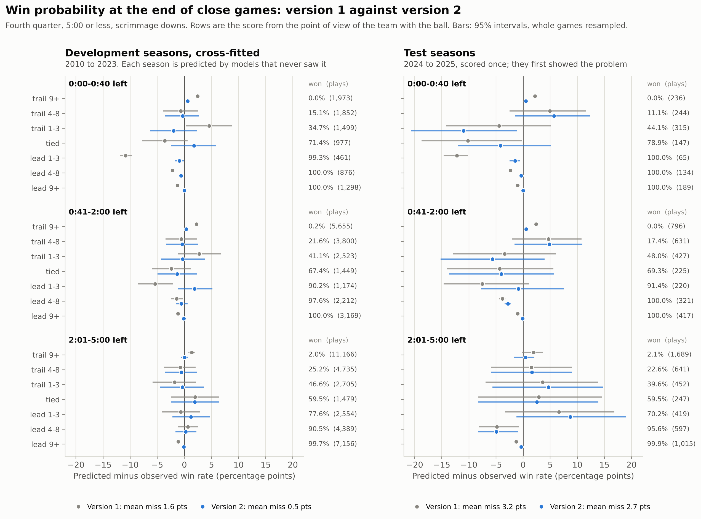

A gradient-boosted model (LightGBM, monotone in score, spread and timeouts) is fitted on 2010 to 2023 and scored on 90,931 plays of 2024 and 2025. Using version 1 inside the decision engine exposed a late-game fault: on first downs with a 1 to 3 point lead and 0:41 to 2:00 left, teams won 95.9% and version 1 said 86.2%. Version 2 starts its trees from a structural baseline (a normal approximation of the final margin plus the kneel-out rule), uses smaller leaves and no calibration map; every choice was made on development seasons and preregistered in [results/m1_wp_v2_preregistration.json](results/m1_wp_v2_preregistration.json) before the test seasons were scored once. It predicts 94.9% in that cell, scores log loss 0.4450 overall (version 1: 0.4490; the improvement's interval, -0.0080 to +0.0001, includes zero) and 0.2372 in the last two minutes (version 1: 0.2523), and ties nflfastR's model with the spread (0.4466). It is still wrong when trailing by 4 to 8 in the last 40 seconds (16.6% predicted, 8.1% observed). A small PyTorch network tied with the trees in a version 1 era comparison ([results/m1_wp_nn.json](results/m1_wp_nn.json)). Numbers: [results/m1_wp_metrics.json](results/m1_wp_metrics.json).

## Decisions and uncertainty

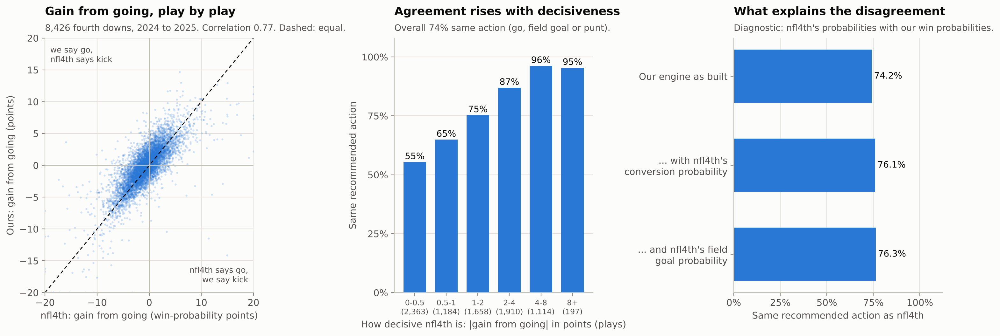

The one-step engine averages win probability over the full outcome distributions of a conversion attempt, a field goal and a punt, using logistic models with splines fitted on development seasons. On 2024 and 2025 it says go on 47.3% of fourth downs, nfl4th on 41.1%; coaches went on 21.3%. The bootstrap resamples whole games, refits the win-probability and play-outcome models 101 times and labels a call confident when at least 83% of refits agree and lean from 67%, the rule of Brill, Yurko and Wyner (arXiv 2311.03490). On calls labelled confident, coaches went for it 49% of the time when the engine said go and kicked 95% of the time when it said kick. For comparison only, that paper reports 48% of 2018 to 2022 fourth downs as confident with its own model (their Section 4.2); samples and models differ. The bootstrap measures sampling noise, not model error: a bias that every refit shares, such as version 1's end-game fault, is still labelled confident. Numbers: [results/m2_nfl4th_comparison.json](results/m2_nfl4th_comparison.json), [results/m3_bootstrap.json](results/m3_bootstrap.json).

## Blown leads

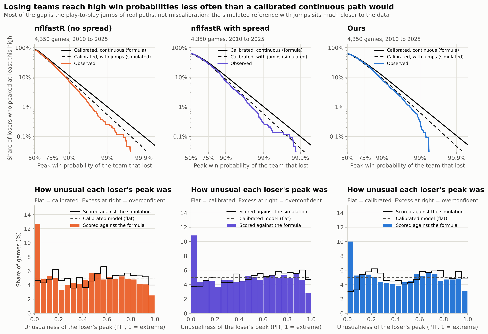

A calibrated win probability is a martingale, so for a continuous path starting at p0 the chance that the eventual loser peaked at x or more is p0 (1 - x) / (x (1 - p0)): in an even game, 11% of losers should have been 90% favorites at some point. Real paths jump from play to play, which makes that formula an upper bound, and a simulated calibrated game observed at play resolution shows the same shortfall the data does. The test that stays exact for jumpy paths (the share of first crossings of a level that end in a loss), with team-season resampling, finds its largest deviation for nflfastR with the spread at 60% (z = 2.36, p = 0.02), which does not survive a correction for 18 tests. This replicates on open models the benchmark of Pipping-Gamon and Wyner (arXiv 2601.18774), who applied it to ESPN's NFL feed and report no detected departure (1,848 games, 2018 to 2024, p = 0.736; their numbers). A second simulation ([results/m3b_sample_size_sim.json](results/m3b_sample_size_sim.json)) reproduces the effective-sample-size point of arXiv 2406.16171: a simple probit model gets about 1.6 to 2.2 independent observations per game, a boosted-tree model 37% to 50% of its plays (the paper reports 56% at 4,101 games; theirs). Numbers: [results/m3b_blown_leads.json](results/m3b_blown_leads.json).

## The exact game solution

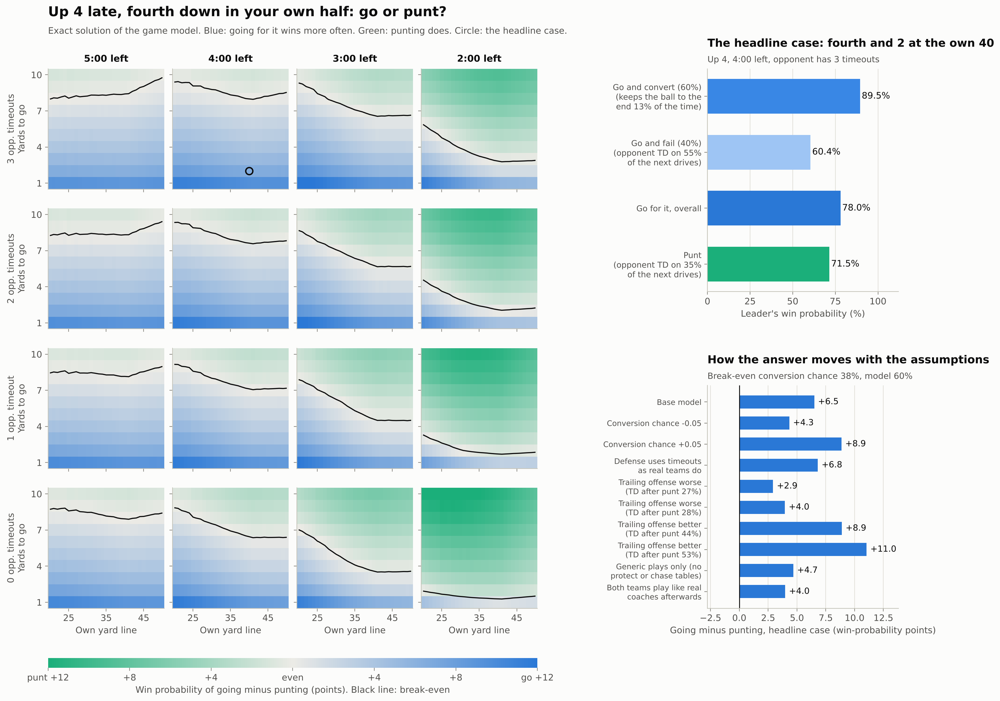

The whole game is a finite-horizon Markov decision process on a 5-second grid: down, distance, yard line, score difference (clipped to plus or minus 21), both teams' timeouts in the last 5:00, kneel-downs, and separate "protect" and "chase" play tables for leading and trailing teams late. Its 407,854,656 states are solved in one backward pass in about 53 seconds on 3 threads. The solver matches a hand-solved game, the "random walk football" recursion of arXiv 2406.16171 and an independent solver on a toy game, and Monte Carlo games under the solved policy match the solved values within noise. Out of sample the simulator matches drives (2.00 points per drive against 2.09 real) but not margins (17.9% of games decided by 17 or more against 28.1%), because both teams are identical. For the headline late-lead case the exact edge for going is 6.5 points against 4.8 one play ahead; replacing optimal play after the decision by coach-like play accounts for 2.4 points of the difference, and the two models' other differences push 0.8 points the other way. Numbers: [results/m4_mdp_summary.json](results/m4_mdp_summary.json), [results/m4_simulator_validation.json](results/m4_simulator_validation.json), [results/questions/q1_late_lead_dp.json](results/questions/q1_late_lead_dp.json).

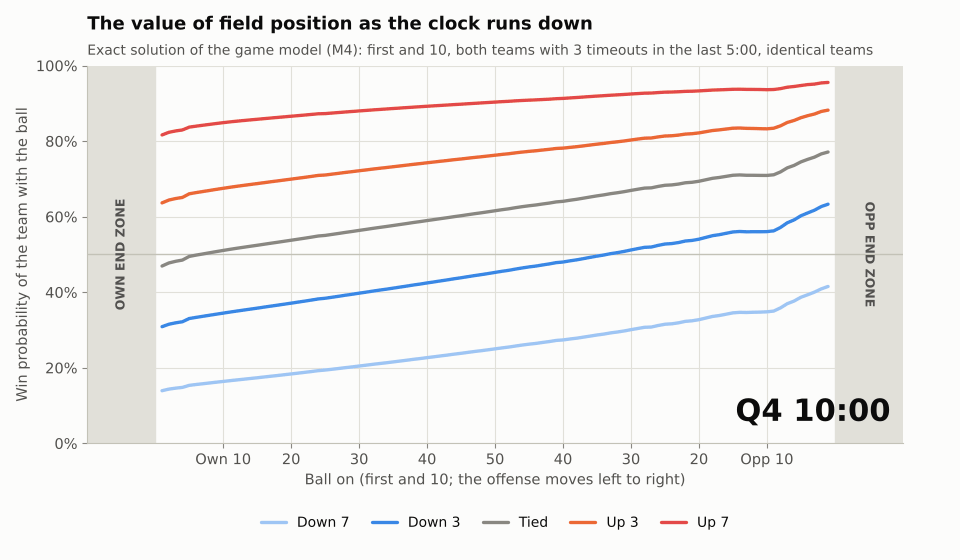

## Reinforcement learning against the exact optimum

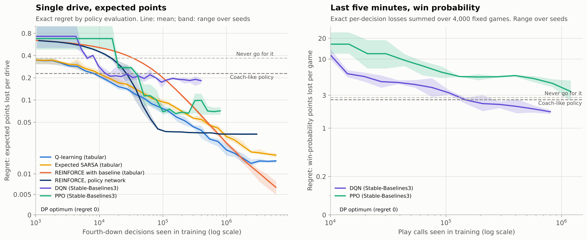

Two Gymnasium environments wrap the solved model, so every agent's regret is measured exactly, not estimated from wins. On the single drive (regret in expected points per drive): REINFORCE with a baseline 0.0064 (its greedy policy 0.0041), tabular Q-learning 0.014, SARSA 0.017, PPO 0.094, DQN 0.17; a coach-like policy loses 0.224 and never going for it 0.357. Close calls are learned last, not rare states: for Q-learning the steps needed to learn a state's action have rank correlation -0.87 with the value gap between the two best actions and -0.42 with how often the state is visited. In the last five minutes (regret in win-probability points per game, summed exactly over decisions), DQN reaches 2.08 (seeds 1.52 to 2.55) after 800,000 play calls and PPO 4.41, still improving; measured the same way, a coach-like policy loses 2.71 and a network fitted directly to the exact optimal values 1.18, so more than half of DQN's remaining gap is the network's inability to represent the optimum. The deep agents got no hyperparameter sweep. Numbers: [results/m5_rl_tabular.json](results/m5_rl_tabular.json), [results/m5_rl_deep.json](results/m5_rl_deep.json).

## Offline RL

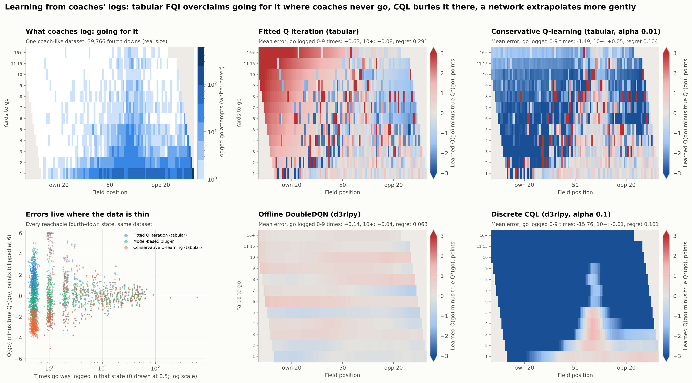

Real data come from coaches' choices, so almost no one has gone for it on fourth and 15 from their own 20. In the known-truth world (hypotheses written into the config before the runs), where coaches never went for it fitted Q iteration overestimates the value of going by 1.1 points on average and CQL underestimates it by 2.6. At the real data size, regret in points per drive: d3rlpy DoubleDQN 0.063, boosted-tree fitted Q iteration 0.084, tabular CQL 0.104, a model-based plug-in 0.135, the coaches 0.224, naive tabular fitted Q iteration 0.291. Always deferring to the coaches' usual call loses 0.098 against the plug-in (interval 0.069 to 0.127). On real 2010 to 2023 fourth downs, CQL agrees with the coaches' usual call 71% of the time against 31% for fitted Q iteration, and off-policy evaluation on 2024 and 2025 cannot rank the learned methods (effective sample sizes of about 2 to 17 of 5,352 drives). Numbers: [results/m6_offline_known_truth.json](results/m6_offline_known_truth.json), [results/m6_offline_real_data.json](results/m6_offline_real_data.json).

## Coaches

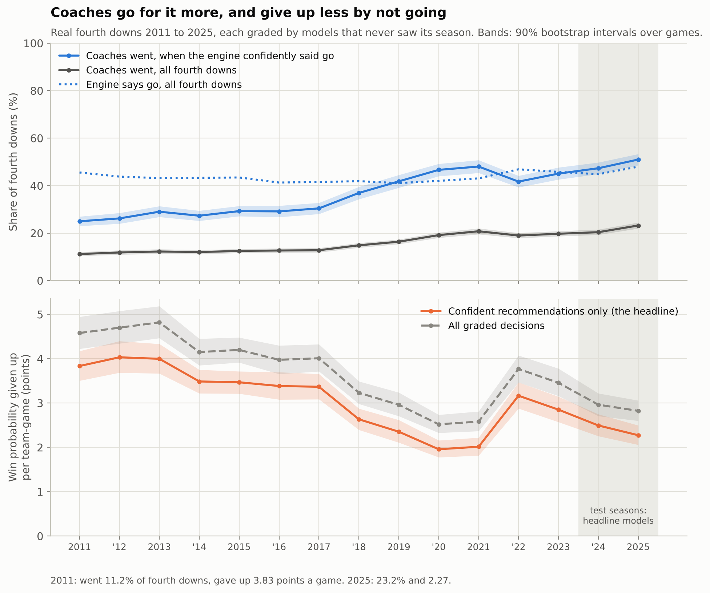

All 58,929 real fourth downs of 2011 to 2025 are graded by the one-step engine with models that never saw the graded season (leave-two-seasons-out folds over 2010 to 2023, development models for 2024 and 2025). Counting only confident calls, coaches gave up 246.5 wins over the period (0.51 per team per 17 games), 92% of it by not going for it. Raw costs mostly ranked eras, so the ledger ranks coaches on cost above the same seasons' league average; that choice and the fold size were made after seeing first results and are recorded in [docs/PLAN.md](docs/PLAN.md). A coach's cost per opportunity correlates 0.27 from one season to the next, against 0.62 for his go rate.

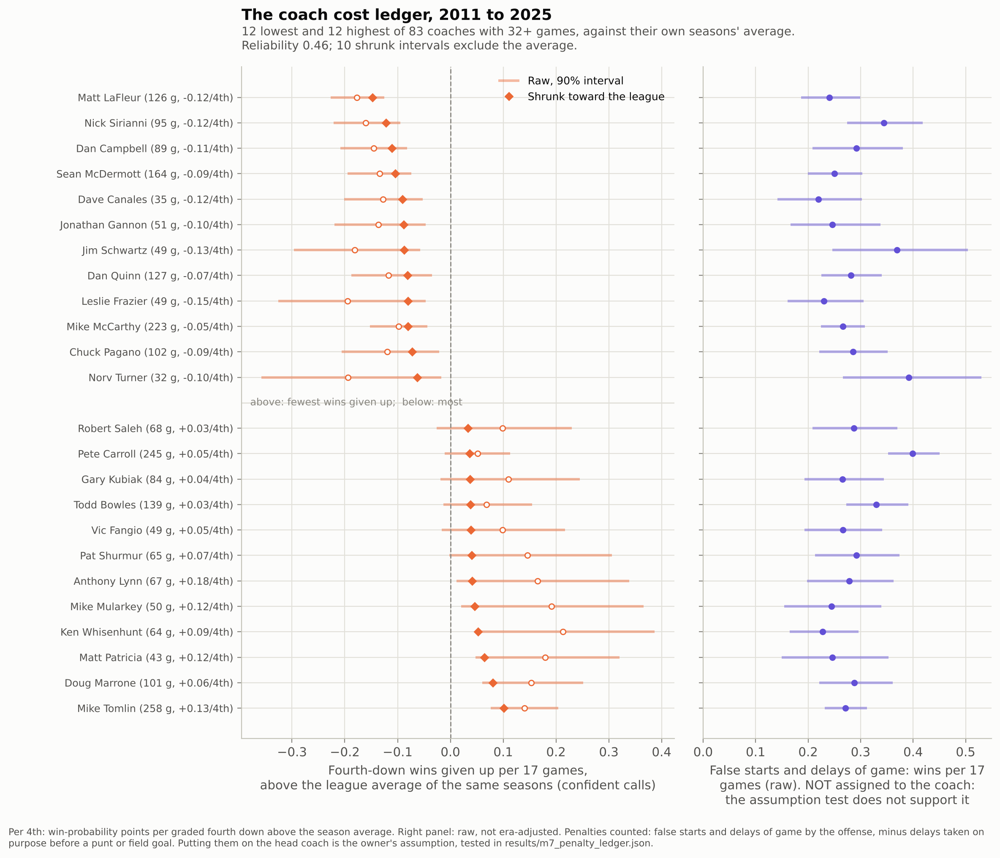

The penalty column prices 10,104 offensive false starts and delays of game (1.41 and 1.28 win-probability points each on average), excluding deliberate delays before punts and field goals. The test of whether these fouls belong to the coach found a coach standard deviation of 0.066 on the log rate (interval reaching zero), and among 31 coach moves the rate stayed with the team (correlation 0.37, interval 0.14 to 0.57) rather than following the coach (-0.09, interval -0.48 to 0.32). Numbers: [results/m7_coach_evaluation.json](results/m7_coach_evaluation.json), [results/m7_coach_ledger.csv](results/m7_coach_ledger.csv), [results/m7_penalty_ledger.json](results/m7_penalty_ledger.json).

## The questions people argue about

### Why do offenses run when passing gains more?

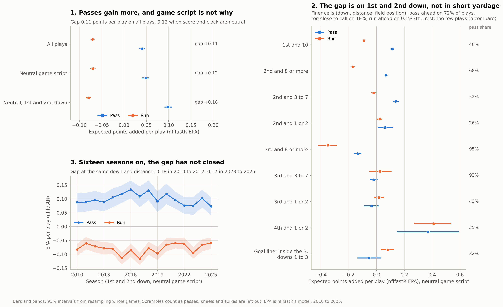

The pass advantage was expected to shrink once game script and situation were held fixed; it grows instead, from 0.11 EPA per play overall to 0.19 on neutral early downs in the same down, distance and field-position cell. It is an early-down gap: on short yardage and at the goal line the run is as good or better, and when protecting a late lead the pass's EPA edge buys no win probability. Counting scrambles as runs, as nflverse records them, shrinks the raw gap from 0.11 to 0.06. This is observational, most teams' pass rates fall between 42% and 61% (5th to 95th percentile), so nothing here says what happens far outside that range, and EPA is nflfastR's model. Numbers: [results/questions/q2_run_vs_pass.json](results/questions/q2_run_vs_pass.json).

### Does the model know our defense is terrible?

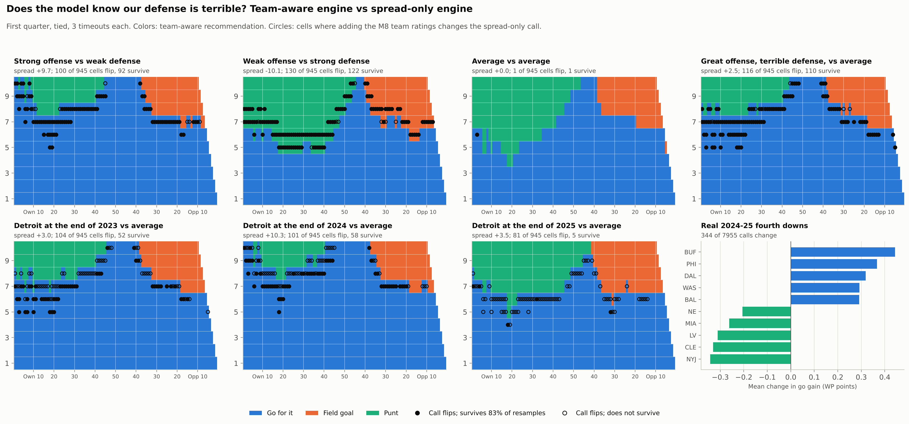

Ratings come from a Kalman filter that reads each week's ratings before that week's games. Through the decision engine, the go-minus-kick margin in a tied first quarter moves by at most 1.45 points in any pairing tested, the largest for a strong offense with a weak defense of its own (the "our defense is terrible" case), and only calls already within about a point flip. Of the 344 changed calls in 2024 and 2025, 55 survive 83% of resamples, and agreement with coaches does not improve. Numbers: [results/m8_team_strength.json](results/m8_team_strength.json), [results/questions/q3_team_aware.json](results/questions/q3_team_aware.json).

### Was it really fourth and 1?

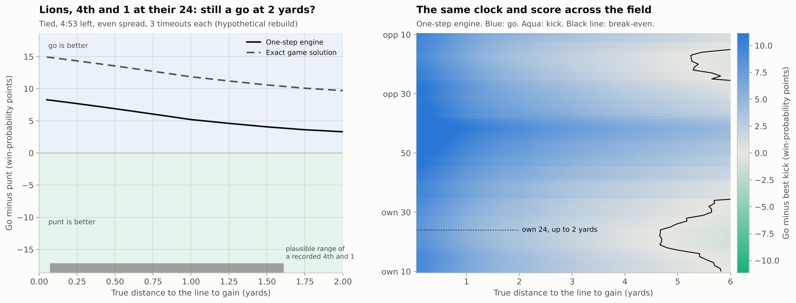

How often plays gain exactly the recorded distance reveals where the line to gain sits inside its recorded yard (about 0.39 of a yard on average after a bias correction). A conversion curve fitted by deconvolution feeds the engine at the plausible true distances. Across error models the share of calls that could flip ranges from 7.2% to 12.1%, and knowing the true distance is worth about 0.003 win-probability points per fourth down. Numbers: [results/m9_distance_error.json](results/m9_distance_error.json).

### Goal line and two-point tries

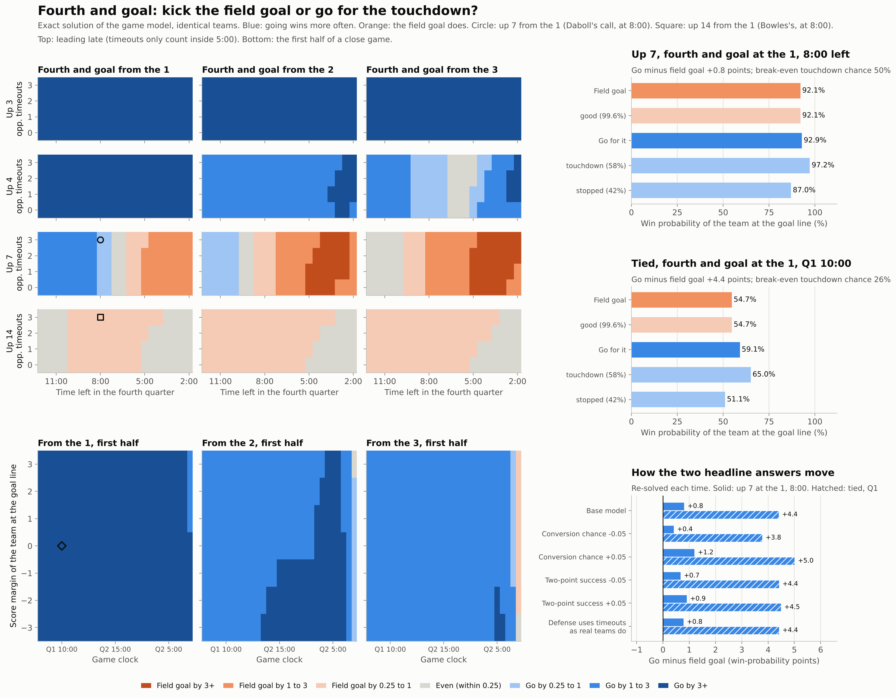

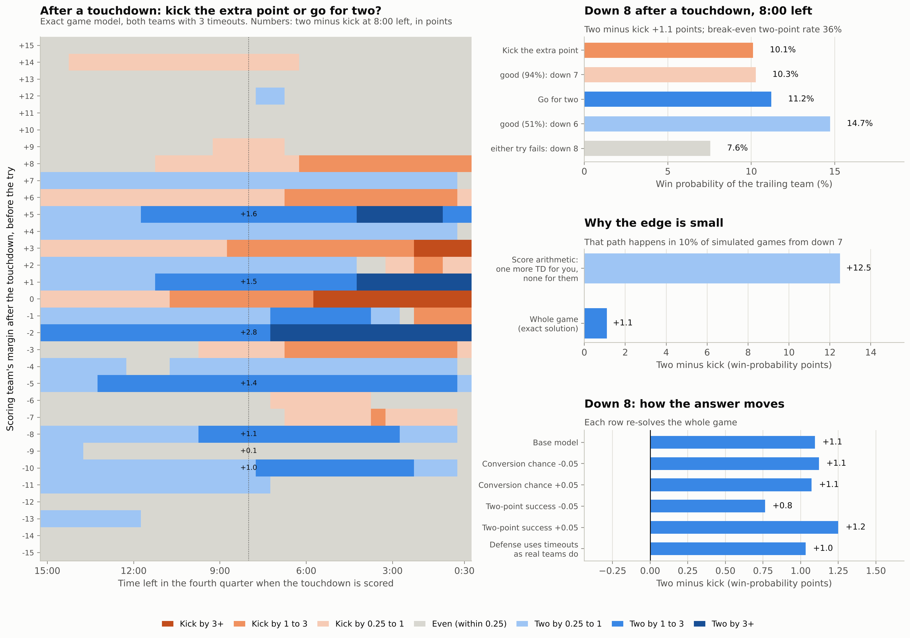

Tied in the first quarter at the 1, going beats the field goal by 4.4 points (break-even touchdown chance 26%). Each sensitivity run (conversion and two-point rates plus or minus 5 points, defensive timeouts at measured rates) re-solves the whole game. The two-point map is fragile: going for two is better in 42% to 75% of its cells as the two-point success rate moves from 46% to 56%. Numbers: [results/questions/q5_goal_line_and_two_point.json](results/questions/q5_goal_line_and_two_point.json).

### How much does being predictable cost an offense?

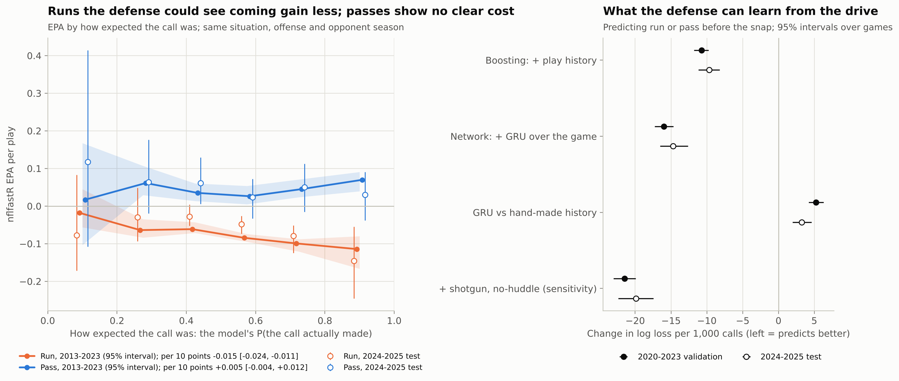

A pre-snap model of each call (gradient boosting with the game's earlier calls; a GRU over the play sequence as the comparison) shows that play history makes calls only modestly more predictable: test log loss falls from 0.525 to 0.515 per call. On 2024 and 2025 the run cost is 0.013 EPA per 10 points of run probability (interval 0.003 to 0.031). The raw, unadjusted run curve points the other way, a lesson in confounding by situation and team. No balance point is claimed, because no team plays far enough from today's mix to support one. Numbers: [results/m10_predictability.json](results/m10_predictability.json).

## Try it

**Streamlit app.** Set a game situation and see each action's win probability, the one-step answer with its bootstrap category and the exact answer side by side:

```bash
pip install -e ".[app]"
streamlit run app/streamlit_app.py
```

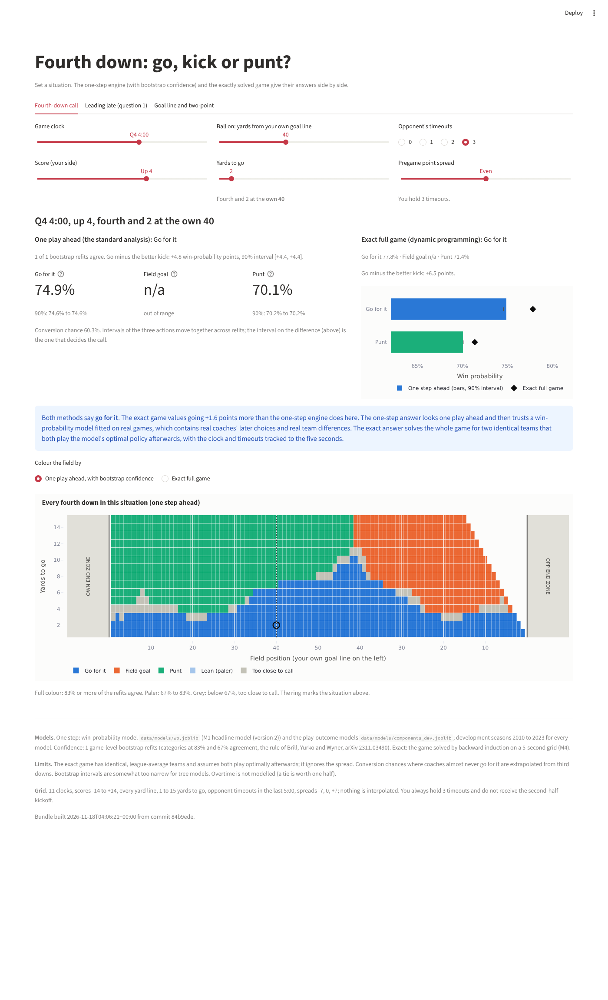

The app reads a precomputed grid under `app/data/` (built by `scripts/m7_build_app_bundle.py`), because the fitted models and the 2 GB solved game are not in the repository; controls snap to grid values and nothing is interpolated.

**Static page.** [`app/fourth_down_explorer.html`](app/fourth_down_explorer.html) is one self-contained file (even spread only) that needs no server; it can be hosted on GitHub Pages once the repository is public.

**Colab notebook.** [`notebooks/fourth_down_demo.ipynb`](notebooks/fourth_down_demo.ipynb) answers a situation both ways and trains a tabular agent against a known optimum on a toy drive model (the real environments need tables that are not in the repository). [Open in Colab](https://colab.research.google.com/github/Varkot-dev/fourth-and-rl/blob/main/notebooks/fourth_down_demo.ipynb); the link works once the repository is public.

## Experimental: a learned world model

On the branch `claude/world-model-colab`, a next-play transformer (6,495,984 parameters) is trained on 2010 to 2021 in a Colab notebook and used to simulate games. Its first run reached a negative log likelihood per transition of 9.654 on the 2024 to 2025 test seasons against 12.998 for a frequency baseline; its simulated win probability scored log loss 0.5252 on 372 test states (95% game bootstrap 0.4616 to 0.5868), against 0.5058 for nflfastR's model without the spread and 0.4628 with it (their models, scored on the same states); it agreed with coaches on 45% of 67 test fourth downs; and for the late-lead case above it said go (0.898) over punt (0.790). That run was undertrained: a bug, since fixed, left the model on the CPU for its 20 minutes of training, and the fourth-down planning was cut short by slow rollouts. Version 2 has not been run yet. Nothing from it enters the results above. Source: `results/world_model/colab_t4_run_summary.md` on that branch.

## Honest limits

- **Identical teams.** The exact game has two identical league-average teams. It must not be used for anything that depends on team strength, and it under-produces blowouts.
- **Extrapolated conversion chances.** Conversion probability is fitted on third and fourth downs together and is extrapolated into situations where coaches almost never go for it, which is where the exact solution is most aggressive. In the first-quarter chart above, the engine recommends going on fourth and 4 at every yard line inside the own 10 and on fourth and 5 or 6 at several of them, mostly labelled confident or lean; that region rests on the thinnest data (conversion and punts near the own goal line) and is a model result, not a recommendation.
- **Bootstrap intervals are too narrow.** The game bootstrap measures sampling noise only, and for tree models it under-covers (77% at a nominal 90% in our simulation; 71% for the plain cluster bootstrap in arXiv 2406.16171, Table 5, theirs).
- **Known model errors.** The win-probability model still over-predicts teams trailing by 4 to 8 in the last 40 seconds. The simulator gives trailing teams a late touchdown on 28.3% of drives against 37.6% in real 2024 to 2025 games (149 drives), which slightly favours punting in the late-lead question.
- **nflfastR comparisons may flatter nflfastR.** Its training seasons are unknown, so its scores on 2024 and 2025 are possibly in sample.
- **The test seasons were looked at more than once.** 2024 and 2025 informed the diagnosis that led to win-probability version 2 and were read by several milestones and an audit, so they are not an untouched test set. The 2026 season is sealed as the final holdout; no model, chart or diagnostic has read it, and it has **not yet been evaluated**.
- **Penalties are not the coach's, as far as this test can tell.** The ledger reports them in a separate column; delays of game alone show a possible coach effect that was found after the main result and is reported only as a lead.
- **RL and offline RL results are about the model, not the NFL.** Deep agents got no hyperparameter sweep. The known-truth offline world gives learners the true terminal values (the easiest case) and has no confounding.
- **The world model is experimental** and undertrained, as described above.
- **Unfinished.** The malpractice check covers only calls from before 2026; the referee question is not built; a planned data clean-up and the final rerun before the 2026 holdout are still to do.

## How it was built

**Data.** nflverse play-by-play through `nflreadpy`, seasons 2010 to 2025 (4,363 games, 729,962 plays), plus participation, penalty and schedule data where needed. The nfl4th reference was produced once by [`scripts/r/nfl4th_reference.R`](scripts/r/nfl4th_reference.R) and saved under `results/reference/`. Column definitions are in [docs/DATA_DICTIONARY.md](docs/DATA_DICTIONARY.md).

**Leakage barriers.** The season split lives in [configs/splits.yaml](configs/splits.yaml) and is enforced in code by `src/fourth_and_rl/splits.py`: development seasons 2010 to 2023, test seasons 2024 and 2025, holdout 2026 (never in the play table). Loading test plays requires a written purpose that is logged; a guard raises `LeakageError` when test rows reach a fit; saved models carry a stamp of the seasons they were fitted on; cache keys include a fingerprint of the data; the main test-season evaluations refuse to run a second time. An independent audit is in [docs/research/leakage_audit.md](docs/research/leakage_audit.md).

**Reproduce.** Python 3.11 or later (3.12 was used). Configuration is in `configs/`, and every results file records its seed.

```bash
pip install -e ".[dev]"          # add ".[rl]" for the RL parts, ".[app]" for the app
python scripts/build_data.py
```

Then, in order: `fit_components.py` and `fit_wp.py` (`--tune`, `--preregister` and `--evaluate` as separate steps); `blown_leads.py` and `wp_sample_size_sim.py`; `decision_chart.py` and `compare_nfl4th.py`; `bootstrap_decisions.py`; `research/endgame_clock_stats.py`, `solve_mdp.py` and `validate_simulator.py`; `questions/q1_late_lead_one_step.py` and `questions/q1_late_lead_dp.py`; `rl_tabular.py` and `rl_deep.py`; `offline_known_truth.py` and `offline_real_data.py`; `questions/q2_run_vs_pass.py`, `m8_team_strength.py`, `questions/q3_team_aware.py`, `m9_distance_error.py`, `questions/q5_goal_line_and_two_point.py` and `m10_predictability.py`; `m7_penalty_ledger.py`, `m7_coach_evaluation.py`, `m7_build_app_bundle.py`, `m7_build_static_page.py` and `m7_value_animation.py`. All live under `scripts/`; each writes its numbers to `results/` and its figure to `assets/`.

**Tests and CI.** `pytest` and `ruff` run on every push through GitHub Actions ([.github/workflows/ci.yml](.github/workflows/ci.yml)); tests that need the cached play-by-play data are marked and skipped there.

**Design record.** Every decision and every change of plan, with the reason, is in the Decision log of [docs/PLAN.md](docs/PLAN.md); teaching notes per milestone are in [docs/NOTES.md](docs/NOTES.md) and [docs/notes/](docs/notes/).

## Sources

- **nflverse** (play-by-play data, and nflfastR's EPA and win-probability models, used as given and labelled as theirs), read with `nflreadpy`.
- **nfl4th** by Ben Baldwin (nflverse), CRAN release 1.0.7, the model behind the fourth-down bot; its numbers are under `results/reference/` and labelled as nfl4th output. Its development version on GitHub already has a game-level bootstrap, timeouts and kneel rules, so this project's bootstrap is a rebuild, not a new method.
- R. S. Brill, R. Yurko, A. J. Wyner, "Analytics, have some humility: a statistical view of fourth-down decision making", arXiv 2311.03490.
- R. S. Brill, R. Yurko, A. J. Wyner, "Exploring the Difficulty of Estimating Win Probability: A Simulation Study", arXiv 2406.16171.
- J. Pipping-Gamon, A. J. Wyner, "The Blown Lead Paradox: A Pathwise Calibration Benchmark for Win Probability Forecasts", arXiv 2601.18774.
- N. Sandholtz, L. Wu, M. Puterman, T. C. Y. Chan, "Learning Risk Preferences in Markov Decision Processes: an Application to the Fourth Down Decision in the National Football League", arXiv 2309.00756 (The Annals of Applied Statistics, 2024).
- D. Romer, "Do Firms Maximize? Evidence from Professional Football", Journal of Political Economy 114 (2006), 340 to 365.
- Biro and Walker, arXiv 2103.06939: a late-game MDP with score and time (without timeouts or kneels, solved approximately), the closest prior work to the exact game solution that was found.
- M. Lopez, arXiv 1909.10631: earlier work on how whole-yard distances hide the true distance, the issue behind the "fourth and 1" question.
- Libraries: LightGBM, scikit-learn, PyTorch, Gymnasium, Stable-Baselines3, d3rlpy, polars, matplotlib, Plotly, Streamlit.

Verified citation details and what was taken from each paper are in [docs/PAPERS.md](docs/PAPERS.md); the survey of existing public work is in [docs/research/landscape.md](docs/research/landscape.md). That survey could not search everything, so this README makes no claim that any part of the project is the first of its kind.

## License

The code is released under the [MIT License](LICENSE). Play-by-play data comes from nflverse under its own terms; papers and tools cited above belong to their authors.
