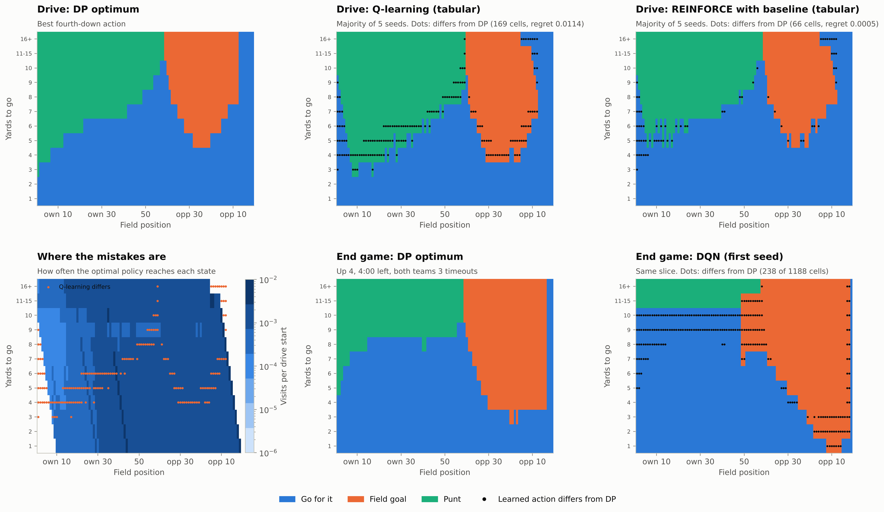
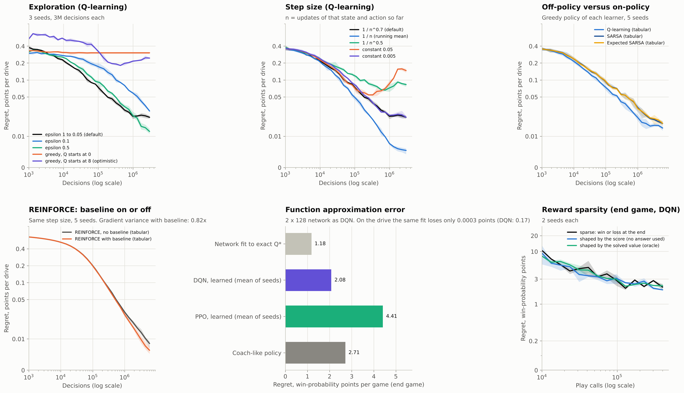

# M5 notes: reinforcement learning measured against the exact optimum

Code: `src/fourth_and_rl/rl/` (`envs.py`, `tabular.py`, `reinforce.py`, `evaluate.py`,
`sb3_utils.py`, `runner.py`, `figures.py`, `toy.py`). Config: `configs/rl.yaml`.
Scripts: `scripts/rl_tabular.py`, `scripts/rl_deep.py`. Tests: `tests/test_rl.py`.
Every number in section 4 comes from `results/m5_rl_tabular.json` or
`results/m5_rl_deep.json`. The environments are built from the frozen snapshot
`data/rl_snapshot/mdp/` (its `meta.json` is copied into both results files).

The point of the milestone: M4 gave the exact optimum of our model. So for once we can
say exactly how far a learning algorithm is from the best possible policy, and how many
simulated decisions it needed to get there. Usually RL papers can only compare algorithms
with each other.

## 1. Concepts

### The agent-environment loop

At each step the environment shows a state s, the agent picks an action a, and the
environment answers with a reward r and the next state s'. The agent never sees the
transition probabilities, only samples:

    s0 --a0--> (r1, s1) --a1--> (r2, s2) --> ... until the episode ends

In Gymnasium this is `obs, info = env.reset(seed=...)` and then
`obs, reward, terminated, truncated, info = env.step(action)` until `terminated`.

In our drive environment one step is one fourth-down decision. Downs 1 to 3 have no
decision in this problem, so the environment plays them itself inside `step`. In the end
game one step is one play call by the agent's team; the opponent's whole possession
happens inside `step` too.

### Return, and why this problem needs no discounting

The return is the sum of rewards from now to the end: G = r1 + r2 + ... + rT. Many RL
problems use a discounted return, G = r1 + g r2 + g^2 r3 + ..., with g below 1, for two
reasons: an endless task would otherwise have an infinite return, and money now is worth
more than money later. Neither applies here. Both of our problems are **episodic**: every
episode ends with probability 1 (a drive ends with a score or a change of possession; the
end game ends when the clock reaches zero). So the plain sum is finite, and it is exactly
the quantity the dynamic program maximized. Discounting would change the problem (a
touchdown three plays from now would be worth less than one now, which is not football).
We use g = 1 everywhere, also in DQN and PPO.

### Value functions and the Bellman equations

- V_pi(s): expected return from s if you follow policy pi.
- Q_pi(s, a): expected return if you take a now and follow pi afterwards.
- V*(s), Q*(s, a): the same for the best policy.

Bellman expectation equation (one policy):

    V_pi(s) = sum over a of pi(a | s) * sum over s', r of P(s', r | s, a) * (r + V_pi(s'))

Bellman optimality equation:

    Q*(s, a) = sum over s', r of P(s', r | s, a) * (r + max over a' of Q*(s', a'))
    V*(s)    = max over a of Q*(s, a)

Worked example from the real model (results of the snapshot). Fourth and 2 at your own
40: Q*(go) = 0.277, Q*(punt) = -0.532 points, no field goal. So V* = 0.277 and the best
action is to go, by 0.81 points. Part of Q*(go): 22.4% of the time the conversion fails
and the other team takes over at their 40, which the model values at -2.584 for us;
18.0% of the time the drive that follows ends in a touchdown, worth 6.95 - 1.21 = 5.74
(the touchdown with its extra point, minus the kickoff we then hand over).

### Why dynamic programming needs the model and RL does not

DP computes the right-hand side of the Bellman equation directly, which needs every
P(s' | s, a). Value iteration (M4 stage 1) applied that update to every state 272 times.
A model-free learner never sees P. It gets one sampled (s, a, r, s') at a time, and has
to average many of them to learn what the sum would have given at once. That is why
learning curves are measured in samples, and why "how many samples" is the question.

### Temporal-difference learning and the Q-learning update

Monte Carlo would wait for the end of the episode and average the returns. Temporal
difference (TD) learning updates after every step, using its own current estimate of
what comes next in place of the rest of the return:

    target = r + max over a' of Q(s', a')        (just r if the episode ended)
    Q(s, a) <- Q(s, a) + alpha * (target - Q(s, a))

This is the Bellman optimality equation turned into a stochastic average: if the
estimates on the right were exact, the expected target would be exactly Q*(s, a).
"Bootstrapping" means using an estimate to update an estimate.

Hand-computed updates from this problem. State: fourth and 2 at your own 40. Step size
alpha = 1 / n^0.7, where n counts the updates of that (state, action) pair.

1. First punt (n = 1, alpha = 1). The opponent takes over at its own 20. The environment
   ends the episode with reward -V*(their first and 10 at their 20) = -0.698.
   Q(punt) = 0 + 1 * (-0.698 - 0) = -0.698.
2. Second punt (n = 2, alpha = 1 / 2^0.7 = 0.616). This one lands at their 15: reward
   -0.462. Q(punt) = -0.698 + 0.616 * (-0.462 + 0.698) = -0.553.
3. A go that converts (n = 1, alpha = 1). The drive goes on, and the next fourth down is
   fourth and 1 at the opponent's 45, where the current estimates are, say, Q = (1.20,
   -0.50, -0.20) for (go, field goal, punt). The reward so far is 0. target = 0 + 1.20,
   so Q(go) = 1.20.

The true values are -0.532 for the punt and 0.277 for going. Each update moves the
estimate toward one noisy sample. A single punt sample is within a few tenths of the
truth, but a go sample can be anything from -5.7 (they return a turnover for a
touchdown) to +5.7 (we score). The worked-example numbers are in
`results/m5_rl_tabular.json` under `worked_example`. Getting Q(go) right to 0.01
points takes thousands of samples of this one state and action.

### Exploration versus exploitation, epsilon-greedy

If the agent always takes the action that currently looks best, it never learns that
another action is better. Epsilon-greedy: with probability epsilon pick a uniformly
random allowed action, otherwise the greedy one. Our default decays epsilon linearly from
1 to 0.05 over the first half of the run: explore broadly early, exploit later. The
alternative tested is **optimistic initialization**: start every Q at 8 points (more than
any return), act greedily, and let disappointment drive exploration. Each tried action
falls toward its true value, so the untried ones look better and get tried.

### On-policy versus off-policy: SARSA versus Q-learning

- **Q-learning** uses max over a' in the target: it learns the value of the greedy
  policy, whatever the agent actually does next. That is **off-policy**: it learns about
  one policy (greedy) from data generated by another (epsilon-greedy).
- **SARSA** uses the action a' the agent actually takes next: target = r + Q(s', a'). It
  learns the value of the epsilon-greedy policy it is following: **on-policy**. If
  exploration is costly near some states, SARSA learns that, and learns a safer policy
  while exploring.
- **Expected SARSA** uses the expectation under the epsilon-greedy policy:
  target = r + (1 - eps) Q(s', greedy) + (eps / k) * sum over a' of Q(s', a'). It is
  on-policy, without the noise of sampling a'.

As epsilon goes to zero all three learn Q*. They differ while epsilon is large.

### Policy gradient and REINFORCE

Instead of learning values, parameterize the policy directly, pi_theta(a | s), and
climb the gradient of J(theta) = expected return. The **log-derivative trick**: for a
trajectory tau with probability p_theta(tau),

    grad J = grad sum over tau of p_theta(tau) G(tau)
           = sum over tau of p_theta(tau) * grad log p_theta(tau) * G(tau)
           = E[ G * grad log p_theta(tau) ]

and log p_theta(tau) = sum over t of log pi_theta(a_t | s_t) + (terms of the
environment that do not depend on theta). So

    grad J = E[ sum over t of G * grad log pi_theta(a_t | s_t) ]

which can be estimated from sampled episodes without knowing P. That is **REINFORCE**.

For a tabular softmax, pi(a | s) = exp(theta[s, a]) / sum over b of exp(theta[s, b]),
and grad log pi(a | s) with respect to theta[s, b] is 1{b = a} - pi(b | s). The update:
after an episode with return G, for each step (s, a):
theta[s, b] += lr * G * (1{b = a} - pi(b | s)).

**Why the variance is high.** The estimate multiplies the whole return G by the score.
If every return is around +5, every action taken gets pushed up, and only the small
differences between returns carry information. **Baseline.** Replace G by G - b(s) for
any b that does not depend on the action. The expectation is unchanged, because
E over a of grad log pi(a | s) = sum over a of grad pi(a | s) = grad 1 = 0. The variance
drops when b(s) is close to the value of s.

Tiny numeric example. One state, two actions, pi = (0.5, 0.5). Action A returns 6,
action B returns 4. The score for theta_A is +0.5 after A and -0.5 after B.
- No baseline: the estimate of dJ/dtheta_A is 6 * 0.5 = 3 or 4 * (-0.5) = -2, each half
  the time. Mean 0.5, variance 6.25.
- Baseline b = 5 (the state's value): (6 - 5) * 0.5 = 0.5 or (4 - 5) * (-0.5) = 0.5.
  Mean 0.5, variance 0.
Same direction, no noise. Our learned baseline is a running average of the returns
seen in each state.

### What Q-learning and policy gradient each estimate

- Q-learning estimates **Q*** (the value of the best policy) and acts greedily on it.
  The policy is implicit. Off-policy: it can learn from any behavior.
- Policy gradient estimates **the gradient of the policy's own value** and moves the
  policy. It never needs Q*, only returns of its own episodes. On-policy: the
  gradient is for the policy that generated the data (data from older policies needs
  importance weights or PPO's clipping).

This is plan question 4.

### DQN

DQN replaces the table by a neural network Q_w(s, a) and minimizes
(r + max over a' of Q_target(s', a') - Q_w(s, a))^2. Two devices make it stable:

- **Replay buffer.** Transitions are stored and minibatches are drawn at random. Two
  steps in a row are strongly correlated (the same game), and gradient descent assumes
  roughly independent samples. Replay also reuses each sample many times.
- **Target network.** The target uses a frozen copy of the network, updated every few
  thousand steps. Without it the target moves with every update (bootstrapping on
  itself), and the regression chases its own tail and can diverge.

Function approximation also brings generalization: one gradient step changes Q for
similar states too. That helps when states share structure, and hurts when the network
cannot represent the true Q.

### PPO

PPO is a policy-gradient method with two additions:

- **Advantage estimation.** It uses A(s, a), an estimate of how much better the action
  was than the policy's average in s, instead of the raw return. A learned value
  function V_phi(s) is the baseline, and GAE (generalized advantage estimation, lambda
  0.95) mixes one-step and multi-step TD errors to trade bias against variance.
- **Clipped objective.** To reuse one batch for several gradient epochs without the
  policy running away from the data, it maximizes
  min(ratio * A, clip(ratio, 1 - 0.2, 1 + 0.2) * A), with ratio = pi_new(a | s) /
  pi_old(a | s). Once the policy has moved 20% on an action, that sample stops pushing.

### Function approximation error

A table can represent any Q, so its only errors come from limited data. A network with
16 inputs cannot represent every function of the state. Even with perfect targets and
unlimited training, its greedy policy can be wrong where two true Q values are closer
than its fitting error. We measure this floor directly by regressing the DQN network on
the exact Q* (section 4).

### Sample efficiency

The number of environment samples a method needs to reach a given quality. DP needs
zero samples but needs the model. Model-free methods need samples, and their counts
are what the sample-efficiency table reports.

## 2. The environments, decision by decision

### DriveEnv: the opponent is a number

The stage 1 Bellman equation (from `mdp_drive.py`) values every way a possession can end:

    other team takes over at their y     -V*(first and 10 at y)
    touchdown                            td_value - K*
    field goal made                      3 - K*
    safety against us                    -2 - F*
    they score a touchdown on the play   -td_value + K*

where K* and F* are the solved values of receiving a kickoff and a free kick. The
environment ends the episode at that moment and pays exactly that number as the reward.
**The opponent's possession is not simulated: it is replaced by minus the solved value of
the position it starts from.** With that terminal reward, the environment's Bellman
equation is the stage 1 equation with the continuation frozen at V*, and V* solves it.
So the environment's optimal policy is the stage 1 optimal policy, and its optimal value
is V*.

This is tested three ways (`tests/test_rl.py`):
- the Bellman residual of V* in the environment is zero (to 1e-7 on the real model);
- policy iteration on the environment alone, starting from scratch, finds a policy whose
  value is V* (toy model);
- the solved optimal policy's mean return in `DriveEnv`, sampled play by play with the
  simulator's own samplers, matches V* of the start distribution within Monte Carlo
  error (real model, 4,000 drives); the batch sampler used by the deep agents is checked
  the same way against exact policy evaluation on the toy model (20,000 drives).

**Why this makes the learner's task easier than the real fixed point.** In the real
problem the value of handing the ball over depends on how the agent itself will play its
next possessions, so what the agent learns feeds back into its own targets, a second
layer of bootstrapping. Here the terminal rewards are exact numbers handed out by the
environment, computed by someone who already knows the optimum. The learner only has to
learn its own drive, in an episode that lasts 1.14 decisions on average under the optimal
policy. An honest full version would make the opponent's possession part of the episode
(an endless game, which needs discounting or the average-reward formulation). That
would be harder and slower to learn, and its optimum would be the same V*.

Two designs give the same distribution. `DriveEnv` (the Gymnasium environment) plays every
down with `Simulator.play["neutral"]` and `Simulator.punt`, the samplers the simulator
uses. The hand-written learners use `CompiledDrive`, which samples from the collapsed
fourth-down-to-fourth-down matrix (downs 1 to 3 summed out exactly with the absorbing-chain
formula (I - P_NN)^-1 P_N,rest). That is about ten times faster per step in plain Python,
and the same matrix gives exact policy evaluation. The test that both match exact policy
evaluation is what ties them together.

Start states: half after a kickoff (the model's kickoff distribution), half at a uniform
yard line. 63% of starts reach a fourth down; the others end before any decision, carry
no information for the learner, and are redrawn. Regret is weighted by the distribution
of the first fourth down. Not-allowed actions (a field goal from too far) are played as
a punt, and `info["action_mask"]` tells which ones are allowed.

### EndgameEnv: a real sparse problem

- The agent's team is whoever has the ball at the start. It makes that team's play
  calls whenever it has the ball: play (neutral), play_protect, play_chase, field_goal,
  punt, kneel, exactly the six action codes of the solved model. On fourth down "play" is
  going for it.
- The opponent's plays are the solved optimal policy (variant: the simulator's coach-like
  policy). Timeouts, two-point decisions and the hurry-up offense's own timeouts are made
  by the simulator as the solver assumed (`post="model"`).
- Reward: 1 win, 0.5 tie after regulation, 0 loss, only at the end.
- Start states (`configs/rl.yaml`): 0:30 to 5:00 left uniform, score within 8 either way,
  70% first and 10 at a uniform yard line, otherwise any down, distance 1 to 15 and yard
  line, timeouts drawn from the measured shares by who leads. States the leader can
  already kneel out are redrawn.
- Actions the model does not allow (protect while trailing, chase while leading, a
  punt before fourth down) are played as the neutral play. SB3 has no masking in its core
  library (that is sb3-contrib, not installed), so this is the documented mapping. At
  evaluation the greedy action is taken among allowed actions only.
- Observation: 16 features in [-1, 1] (time, inside-the-warning flag, score and five score
  flags, down one-hot, distance, yard line, both teams' timeouts), or the index into the
  solved array for tabular use.

Every play goes through `Simulator.advance`, the function the M4 simulator uses, so the
environment cannot drift from the solved model. The test: the solved policy's mean
result over 20,000 games equals the mean solved value of the starts within Monte Carlo
error (real snapshot and toy game).

### Measuring the end game without Monte Carlo noise in the win rate

A win rate over 4,000 games has a standard error of 0.75 points, about as large as the
differences we want to see. Instead the evaluation uses the identity

    V*(s0) - V_pi(s0) = E_pi[ sum over the agent's decisions of V*(s_t) - Q*(s_t, a_t) ]

(the performance-difference lemma with the optimal policy as reference). It holds because
V* is the optimal value of the agent's problem (the opponent and the timeout decisions
are fixed and optimal, so V* is preserved in expectation between the agent's decisions),
so the value can only leak at the agent's own decisions, by exactly the loss of each one.
`evaluate.build_loss_table` computes V* - Q* for every one of the 196 million end-game
states and six actions with the solver's own `Solution.backup`, saved as float16
(2.4 GB, memory-mapped, under `data/rl/`). Games in which the agent never errs contribute
exactly zero, so the noise drops by a factor of about 7. Checked on the real model, on
the 4,000 evaluation games: for the coach-like policy the summed losses give 2.59 points
(standard error 0.09) and the drop in win rate gives 2.77 (standard error 0.75); for
"never go" 2.79 and 2.90; for random actions 21.29 and 21.36.

Exact evaluation by a backward pass with the agent's actions fixed was considered and
rejected. `mdp_game` stores one array for both teams (the "1 minus V" trick), which
assumes both teams play the same way. With the agent on one side and the optimal policy
on the other, the evaluation needs two arrays and a modified backup, plus a network
evaluation on all 196 million states per checkpoint. The loss-sum estimator is unbiased
and cheap.

## 3. The agents and their settings

| Agent | Where | Setting (all in `configs/rl.yaml`) |
|---|---|---|
| Q-learning, SARSA, Expected SARSA | drive, plain Python | epsilon 1 to 0.05 linearly over the first half; step size 1 / n^0.7 per (state, action); Q starts at 0; 6M decisions; 5 seeds |
| Q-learning, optimistic | drive | Q starts at 8, greedy, constant step 0.05 |
| REINFORCE (tabular softmax) | drive | step 0.05; baseline = per-state running mean of returns (step 0.05); with and without baseline; 6M decisions; 5 seeds |
| REINFORCE (network) | drive, PyTorch | 2 x 64 tanh policy and value networks, Adam 3e-3, 1,024 episodes per update; loss written by hand; 3M decisions; 3 seeds |
| DQN (SB3) | drive and end game | 2 x 128, Adam 5e-4, replay 200k, batch 256, 4 gradient steps per 64 transitions, target network every 2,000 steps, epsilon 1 to 0.05 over 30%, gamma 1; 400k (drive) and 800k (end game) steps; 3 seeds |
| PPO (SB3) | drive and end game | 2 x 128, Adam 3e-4, 64 environments x 256 steps per update, 4 epochs, batch 2,048, clip 0.2, GAE lambda 0.95, entropy 0.01, gamma 1; 800k and 1.2M steps; 3 seeds |

The tabular defaults were fixed before any run, from textbook ranges. They were not tuned
afterwards. The ablations show what tuning would have bought (section 4), and the main
curves stay as they were. The deep hyperparameters are SB3-style defaults adjusted for
gamma = 1 and 64 parallel environments, from one smoke test, not a sweep.

A "step" is one decision of the agent: a fourth-down call on the drive (about 0.9 drives
per step, since 1.14 decisions per drive), a play call in the end game (6.0 play calls per
game, so 800k steps is 133k games).

## 4. Results

### Drive (exact regret in expected points per drive, 5 seeds unless noted)

The environment: 1,188 fourth-down states, 1,073 of them reachable; 63% of drive starts
reach a fourth down; 1.14 decisions per episode under the optimal policy; the optimal value
of the start distribution is 0.613 points.

Reference policies: never go for it 0.369; always go 0.328; coach-like (observed
frequencies) 0.228; random 0.675.

| Agent | Decisions | Final regret: mean, sd over seeds (range) | To 0.05 | To 0.01 |
|---|---|---|---|---|
| Q-learning | 6M | 0.0150, 0.0006 (0.0141 to 0.0156) | 0.30M | not reached |
| SARSA | 6M | 0.0183, 0.0013 | 0.54M | not reached |
| Expected SARSA | 6M | 0.0179, 0.0009 | 0.54M | not reached |
| Q-learning, optimistic greedy | 6M | 0.261, 0.014 | never | never |
| REINFORCE with baseline (the stochastic policy) | 6M | 0.0067, 0.0011 (0.0049 to 0.0081) | 0.54M | 4.4M |
| same, its greedy policy | | 0.0044 | 0.16M | 1.3M |
| REINFORCE without baseline | 6M | 0.0090, 0.0011 | 0.73M | 6.0M (4 of 5 seeds) |
| REINFORCE network (3 seeds) | 3M | 0.0345, 0.0011 | 0.08M | not reached |
| DQN (3 seeds) | 0.4M | 0.183, 0.014 | not reached | not reached |
| PPO, greedy (3 seeds) | 0.8M | 0.071, 0.008 (stochastic policy: 0.100) | not reached | not reached |
| Q-learning, step 1 / n (ablation, 3 seeds) | 3M | 0.0057, 0.0006 | 0.11M | 0.99M |
| DP (value iteration) | 0 samples | 0 | 272 sweeps x 4,752 states = 1.3M backups touching 191M transition probabilities, 0.21 s | |

"To 0.05" is the first checkpoint from which the mean curve stays below the line.

What it shows:

1. **The TD learners beat the coach-like policy after about 10^4 decisions** (about 9,000
   drives), REINFORCE only after about 10^5 (it starts from a uniformly random policy,
   which is worse than the coach, and moves slowly at first). The best get within 0.01
   points per drive after one to four million decisions.
   DP needs no samples but needs the model.
2. **REINFORCE ended up ahead of Q-learning, and the reason is the step size, not the
   algorithm.** With alpha = 1 / n^0.7, Q-learning keeps a noise floor: its effective
   averaging window grows only like n^0.7, and the single-sample targets are very noisy
   (the return of one drive has a standard deviation of 2.8 points, while the median
   action gap is 0.54). With alpha = 1 / n, a plain running mean, Q-learning reaches
   0.0057 in half the steps. This problem is almost a bandit (1.14 decisions per episode,
   so little bootstrapping), which is the case where 1 / n is ideal. With long episodes
   and heavy bootstrapping, 1 / n is known to be too slow.
3. **On-policy versus off-policy.** SARSA and Expected SARSA are slightly worse than
   Q-learning (0.018 against 0.015) because they learn the value of the epsilon-greedy
   policy, which is not quite what the evaluation measures. With epsilon at 0.05 at the
   end, the difference is small. Expected SARSA did not beat SARSA here.
4. **The deep agents are worse than tables on the drive, for diagnosable reasons, not
   because a network cannot represent the answer.** The same 2 x 128 network fitted
   directly to the exact Q* has a regret of only 0.0002 (9 states differ). So:
   - DQN after 400k steps: its Q-values are wrong by 0.53 points in the action
     differences (visit-weighted). That equals the median gap between the best and
     second-best action (0.54), so on about half of the visits it is guessing. Its values
     are also biased low by 0.3 points. The budget gave it 25,000 gradient steps; it is
     not converged.
   - The REINFORCE network converged prematurely. Its regret stopped improving after
     about 100k decisions; at the end its policy is deterministic (mean entropy 0.0001
     nats), and 10% of visits sit in states where it is certain and wrong. A softmax with near-zero probability on an action gets almost no
     gradient for it, so it never comes back. An entropy bonus or a smaller step size is
     the usual fix. It was not tried, to keep to the rule of not tuning after looking.
   - PPO is still improving at 800k.

### Where the learned policies differ from the optimum

- Weighted by how often the optimal policy visits each state, the greedy Q-learning
  policy agrees with DP on 90% of decisions (each seed 0.896 to 0.902), REINFORCE on 94% to
  97%. Majority over seeds: Q-learning differs from DP in 139 of 1,073 reachable states
  (regret 0.0137), REINFORCE in 38 (regret 0.0010).
- **Which states are learned last.** For each state, the checkpoint from which the greedy
  action stays optimal. The rank correlation with the action gap is -0.87, with the visit
  frequency -0.43. **Close calls are learned last, more than rare states.** The rarest
  quarter of states is learned by the end in 81% of cases against 95% for the most visited
  quarter (median 403k against 27k decisions). The dots in the figure sit along the
  boundaries between actions, where the gap is near zero. Getting a state with a gap of g
  right needs on the order of (2.8 / g)^2 samples of each action (2.8 is the standard
  deviation of one drive's return). For a gap of 0.05 points that is about 3,000 per
  action, so about 9,000 visits, and a state visited 0.001 times per drive gets those
  after about 9 million drives.
- That is also why these mistakes are cheap. A wrong action in a close call loses only
  the small gap, which is why 10% disagreement costs only 0.015 points.

### End game (regret in win-probability points per game, 4,000 fixed games, 3 seeds)

| Agent | Play calls (games) | Final regret: mean, sd (range) | Within 1 point | Within 0.2 |
|---|---|---|---|---|
| DQN | 800k (133k) | 1.73, 0.11 (1.61 to 1.83) | not reached | not reached |
| PPO | 1.2M (193k) | 3.40, 1.32 (2.48 to 4.91), still improving | not reached | not reached |
| Network fit to exact Q* (the representation floor) | | 1.29 (standard error 0.04) | | |
| Coach-like policy | | 2.59 | | |
| Never go for it (otherwise optimal) | | 2.79 | | |
| Random actions | | 21.3 | | |
| DP | 0 samples | 0 (199M state backups for the last 5:00, about 21 s) | | |

The evaluation standard error per checkpoint is 0.05 to 0.2 points.

1. **DQN beats the coach-like policy after about 150k play calls** (25k games) and ends
   at 1.7 points per game from the optimum. PPO ends at 3.4 and is still improving.
   Neither reaches 1 point in the budget.
2. **Most of DQN's remaining gap is function approximation.** The same network trained
   by regression on the exact Q* of 400k states visited by the optimal policy still loses
   1.29 points. With 16 hand-made features and 2 x 128 units, it cannot separate actions
   whose values differ by a fraction of a point across 196 million states. DQN at 1.73
   is within 0.45 of that floor. On the drive the floor is 0.0002, so there the problem
   was learning, not representation.
3. **Reward sparsity: no measurable effect at this budget.** After 400k steps (2 seeds),
   sparse 2.13, shaped by the score (a potential that needs no answer) 2.00, shaped by the
   solved value (an oracle potential) 2.30. The differences are within seed noise.
   Potential-based shaping with gamma = 1 shifts every Q(s, a) by the same phi(s), so it
   leaves the action gaps, which are what DQN struggles to resolve, unchanged. It helps
   with credit assignment over many steps, and with 6 decisions per game and bootstrapped
   targets that was not the bottleneck. The shaped curves start lower (they learn the
   rough value of states sooner) and then converge to the same place.
4. **Against the coach-like opponent** (DQN, 1 seed, 800k steps), the win rate on the
   same 4,000 games is 0.615, against 0.630 (standard error 0.007) for the solved policy
   and 0.601 for coach against coach. The solved policy is optimal against an optimal
   opponent, not a best response to the coach, so it is a reference, not a ceiling. There
   is no exact regret here because nobody solved "best response to the coach".

### Ablations

Q-learning, 3 seeds, 3M decisions (final regret, points):

- Exploration: linear decay 0.0215; constant epsilon 0.1 0.0277; constant 0.5 **0.0114**;
  greedy with Q at 0 0.299 (it never explores, locks in whatever looked best after one
  sample). More exploration is better here. Q-learning is off-policy and its greedy
  policy is what we evaluate, so exploring costs nothing in the measured number, while
  rare actions get more samples.
- Optimism: greedy with Q at 8 and a constant step of 0.05 gives 0.234; with the
  count-based step 0.347. With alpha = 1 at the first visit, the first update overwrites
  the optimistic value with one sample, so the optimism is gone after one try. Even with a
  constant step, one unlucky sample makes an action look worse than its rivals forever,
  because nothing makes the agent try it again. Optimism works for deterministic or
  low-noise rewards; with noise this large it is not enough exploration.
- Step size: 1 / n^0.7 0.0215; **1 / n 0.0057**; 1 / n^0.5 0.090; constant 0.05 0.167
  (gets worse over time: a constant step never averages the noise away, and once epsilon
  is small the greedy policy chases noise); constant 0.005 0.0218.
- REINFORCE step size (3 seeds, 3M): 0.02 0.0169, 0.05 0.0104, 0.2 0.0279.
- REINFORCE baseline: with 0.0067, without 0.0090 at 6M (5 seeds each). The measured
  gradient variance with the exact value as baseline is 0.82 times the variance without
  it at the uniform policy (0.87 half way to the optimal policy, 100,000 episodes). That
  is much less than the textbook example, because in this problem the noise is mostly
  within a state (what happens on the drive), not between states. A baseline removes only
  the between-state part. (Those Monte Carlo means differ by 13% between the two
  estimators, which is sampling noise of a 3,000-parameter mean; the identity says they
  are equal.)

## 5. Design decisions someone could challenge

1. **The opponent's possession is a number (DriveEnv).** Easier than the true fixed
   point, as explained in section 2. Chosen so the environment's optimum is exactly stage
   1 and regret is exact.
2. **Downs 1 to 3 inside the environment.** The agent decides only on fourth down because
   the stage 1 model has no other decision. Steps are therefore fourth-down decisions, not
   plays.
3. **Two samplers for the drive.** `DriveEnv` uses the simulator's samplers play by play,
   while the hand-written learners use the collapsed fourth-down-to-fourth-down matrix,
   for speed. Their agreement is tested, not assumed.
4. **End-game regret by summed exact losses**, not win counts and not an exact backward
   pass. It is unbiased (the performance-difference identity) and checked against win
   rates. It is valid only against the optimal opponent.
5. **Invalid actions mapped, not masked**, during SB3 training (no masking in core SB3).
   Mapped actions duplicate "play", which wastes some exploration. Evaluation masks.
6. **Start distribution of the end game is ours** (uniform over 0:30 to 5:00, score within
   8, mostly first and 10). Regret numbers depend on it.
7. **Not tuned after looking.** The tabular defaults lost to one ablation setting (1 / n).
   I report the default as the main result and the better setting as an ablation. The
   REINFORCE network's collapse was diagnosed but not fixed.
8. **Budgets.** The deep agents are not converged. With more steps PPO would improve, and
   DQN would probably approach its floor of about 1.3 points.

## 6. Things to be able to say without notes

1. The agent-environment loop, and why there is no discount here.
2. The Bellman expectation and optimality equations, and the hand Q-learning update for
   fourth and 2 at the own 40.
3. Why DP needs the model and RL does not, and DP's cost compared with the learners'
   samples (0.2 seconds against a million decisions).
4. Q-learning versus SARSA: target, on-policy or off-policy, what each converges to while
   exploring.
5. REINFORCE: the derivation, why a baseline does not bias it, why it helped little here.
6. What Q-learning and policy gradient each estimate (plan question 4).
7. DQN's replay buffer and target network; PPO's clipped ratio and advantages.
8. How the drive environment represents the opponent, and why that makes learning
   easier than the real fixed point.
9. How end-game regret is measured, and why it is far less noisy than a win rate.
10. Why close calls are learned last, and why getting them wrong costs little.
11. Why the step size mattered more than the algorithm on the drive.
12. Representation floor versus learning error: 0.0002 against 0.18 on the drive, 1.29
    against 1.73 in the end game.

## 7. Not done, and what would come next

- The optional tabular Q-learning on a coarsened end game was not built.
- No sweep of the deep agents; PPO and the REINFORCE network are not converged or are
  stuck. An entropy bonus for the network and longer PPO runs are the obvious next tries.
- The coach-opponent variant has no exact optimum (a best response to the coach would need
  a second backward pass with the opponent's policy fixed).
- All numbers are about the model, not about the NFL. The model's caveats (M4 notes)
  carry over unchanged.

## Final rerun on the hardened solution

The results above were produced on the solved model from before the leakage hardening. The whole milestone was rerun on the final solved model (development-only tables, the corrected coach two-point rule). Numbers from `results/m5_rl_tabular.json` and `results/m5_rl_deep.json`:

| Agent | Single drive, regret (points per drive) | Last five minutes, regret (win-probability points per game) |
|---|---|---|
| REINFORCE with baseline (tabular) | 0.0064 (greedy 0.0041) | |
| Q-learning (tabular) | 0.014 | |
| SARSA / Expected SARSA | 0.017 / 0.017 | |
| REINFORCE network | 0.030 (one seed stuck at 0.067) | |
| PPO | 0.094 | 4.41, still improving |
| DQN | 0.17 | 2.08 (range 1.52 to 2.55) |
| Coach-like policy | 0.224 | 2.34 (win-rate gap, standard error about 0.75) |
| Never go for it | 0.357 | 3.50 (win-rate gap) |
| Network fitted to the exact optimum | | 1.67 (win-rate gap) |

What changed: the tabular results are within a few thousandths of the earlier run. In the end game DQN is somewhat weaker than before (2.08 against 1.73) and is now roughly level with the coach-like policy within noise, while PPO is still improving at the end of its budget. The lessons of this note are unchanged: dynamic programming gets regret 0 by using the model, the learners need millions of decisions to approach it, close calls are learned last, and in the end game most of the remaining gap is function approximation.

