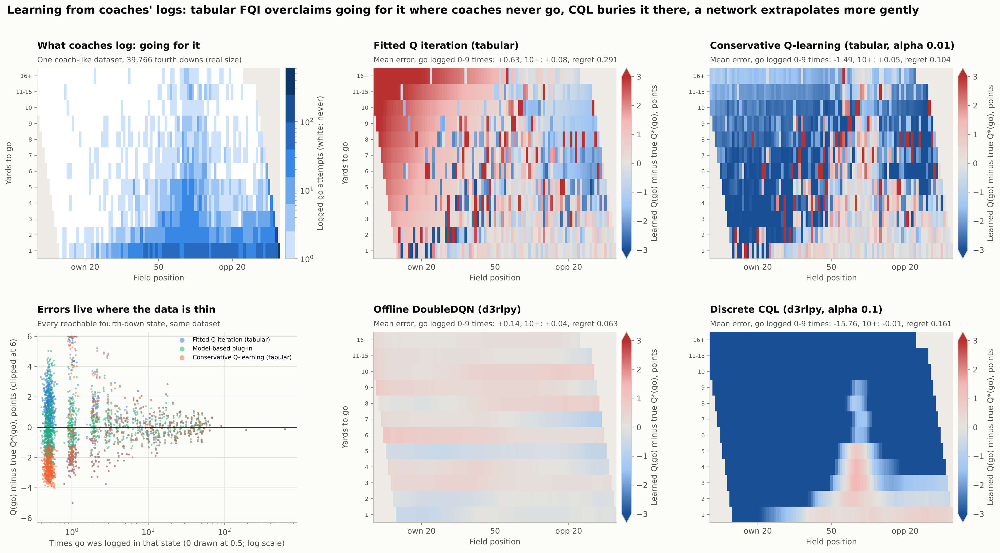
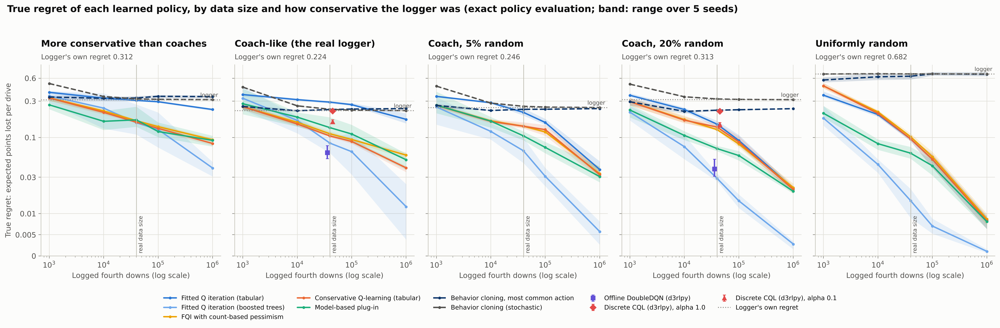
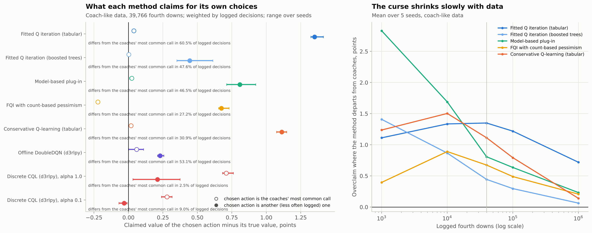
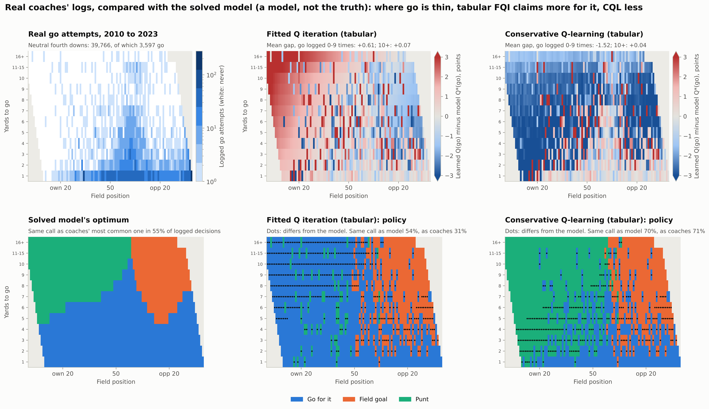

# M6 notes: offline reinforcement learning on logged coaching decisions

Code: `src/fourth_and_rl/offline/` (`datasets.py`, `learners.py`, `deep.py`, `measure.py`,
`real.py`, `figures.py`). Config: `configs/offline.yaml`. Scripts:
`scripts/offline_known_truth.py` (Part A), `scripts/offline_real_data.py` (Part B).
Tests: `tests/test_offline.py`. Every number in sections 5 and 6 comes from
`results/m6_offline_known_truth.json` or `results/m6_offline_real_data.json`; worked
examples marked "illustration" were computed by hand for these notes.

The question of the milestone: real data comes from coaches' choices, not from
exploration. Coaches almost never go for it on fourth and long in their own half, so the
data says almost nothing there. What happens when a policy is learned from such logs, and
does a conservative method fix it?

## 1. Concepts

### Online versus offline RL

In M5 the agents were **online**: they chose actions, the simulator answered, and they
could try anything as often as they liked. Q-learning explored with epsilon-greedy until
every action had been tried thousands of times in every state that matters.

**Offline** (or batch) RL gets a fixed dataset of transitions (s, a, r, s') collected by
somebody else, and may not collect more. Every real football dataset is offline: we
cannot ask a coach to go for it on fourth and 15 from his own 20 a thousand times to see
what happens. The algorithm has to produce a policy from what was logged, and the policy
it produces will then be judged on states and actions the logger may hardly ever have
visited.

### The behavior policy and coverage

The policy that produced the data is the **behavior policy**, written mu(a | s). Here it
is the coaches. What the data can tell you about an action a in a state s depends on how
many times (s, a) was logged, roughly N * d_mu(s) * mu(a | s), with N the number of logged
decisions and d_mu(s) the share of decisions taken in state s.

**Coverage** is the property that the data contain every (s, a) the policy you care about
would use. If the policy you want to learn (or to evaluate) puts weight on an action that
mu almost never takes, the data cannot pin down that action's value, however large N is.

Worked example from this problem (`worked_example` in the Part A results): fourth and 15
at the own 20. The coach-like behavior goes for it there with probability 0.0017 and
punts otherwise. In a dataset the size of our real one (39,766 fourth downs) the state
appears about 42 times, so going for it is expected to be logged 0.07 times: in almost
every dataset, never. The true values are Q*(go) = -2.41 and Q*(punt) = -1.43 points.

### Why naive off-policy learning fails on logged data

Q-learning and fitted Q iteration are **off-policy**: their target
r + max over a' of Q(s', a') does not care which policy chose the actions, so in principle
they can learn Q* from anybody's data. Three things break that in practice when coverage
is poor:

1. **Extrapolation.** For an (s, a) with no data, the learned value is whatever the
   function class makes of it. A table keeps its initialization; a tree or a network
   extrapolates from similar inputs. Nothing in the loss corrects it, because no data point
   is there to disagree.
2. **The max operator's upward bias.** Even where an action has a few samples, its estimate
   is noisy, and the greedy step takes the maximum over actions. The maximum of noisy
   estimates is biased upward: E[max of estimates] >= max of true values. An action with
   few samples has the noisiest estimate and wins the max more often than it should.
3. **Bootstrapping from out-of-distribution actions.** The target of every logged
   transition uses max over a' of Q(s', a') in the next state. If one action in s' is
   overestimated (by 1 or 2), every state that leads to s' inherits the error, including
   states that are well covered. In online RL the agent would try the overestimated action,
   be disappointed and correct it. Offline, nobody ever tries it.

Numeric example (the state above). A tabular FQI starts every Q at 0. Go is never logged,
so Q(go) stays at 0. Punting is logged about 42 times and its estimate converges near the
true -1.43. The greedy action is therefore go, valued at 0, when its true value is -2.41:
an overclaim of 2.4 points, and a real mistake that costs about 1 point every time the
state is reached. With exactly one logged go, its estimate is one sampled outcome. That one
sample's target beats the punt's value with probability 0.20 (a conversion), so in one
dataset out of five FQI would recommend going on fourth and 15 from its own 20, and would
claim for it the value of a conversion.

### Fitted Q iteration, step by step

FQI (Ernst, Geurts and Wehenkel 2005) is value iteration where the Bellman backup is
replaced by a regression on the logged transitions.

1. Start with Q_0 (here 0 everywhere).
2. For every logged transition i = (s_i, a_i, r_i, s'_i), form the target
   y_i = r_i + max over allowed a' of Q_k(s'_i, a'), or just r_i if the drive ended.
3. Fit Q_{k+1} by least squares: minimize the sum over i of (Q(s_i, a_i) - y_i)^2 over the
   function class (a table, trees, a network).
4. Repeat until Q stops changing. Act greedily on the result.

With a table, step 3 sets Q(s, a) to the average target of the transitions logged in that
cell, and cells with no data keep their old value. So tabular FQI is exactly value iteration
in the **empirical MDP** (the transition probabilities replaced by logged frequencies),
with the unlogged cells frozen at the initialization. That identity is why FQI and the
"certainty-equivalent" model-based answer agree wherever the data is complete, and differ
only in how they handle what is missing.

Implementation note: for squared error, the sum over transitions equals the count-weighted
sum over cells plus a constant, sum over i of (q(s_i, a_i) - y_i)^2 = sum over cells of
n(s, a) (q(s, a) - T(s, a))^2 + const, where T(s, a) is the average target in the cell. So
every learner here runs on the count tensor C[a, s, c] (how often action a in state s led to
outcome c), which makes its cost independent of the dataset size. This is an identity, not
an approximation (one small difference for the trees: their minimum leaf size counts cells,
not transitions).

The episodes are short (1.14 decisions per drive under the optimum, M5), and the targets
of drive endings are exact numbers (the points scored minus the solved value of what the
other team then holds, M5's DriveEnv), so FQI converges in about 10 iterations.

### Conservative Q-learning (CQL)

CQL (Kumar, Zhou, Tucker and Levine 2020) adds a penalty to the FQI regression. For the
discrete-action version used here and in d3rlpy, the loss per logged transition is

    1/2 (Q(s, a) - y)^2  +  alpha * ( log sum over a' of exp Q(s, a')  -  Q(s, a) )

The first term is FQI. The second is the **conservative penalty**: the log-sum-exp is a
soft maximum over all actions in s, and subtracting the logged action's Q means the penalty
is small only when the logged action already has the highest value. Its gradient with
respect to Q(s, b) is alpha * (softmax(Q(s))_b - 1{b = a}).

Summed over the logged transitions of one state, with mu(a | s) the logged action shares and
pi = softmax(Q(s)), the gradient for action b is

    mu(b|s) (Q(s, b) - T(s, b))  +  alpha * (pi(b|s) - mu(b|s))

What it does to the Q-values:
- Q is pushed **down** in proportion to pi (what the current Q would choose) and **up** in
  proportion to mu (what the data shows). Actions the data favors can rise above their
  FQI value; actions the data rarely shows sink.
- The stationary point for a logged action is
  Q(s, b) = T(s, b) - alpha * (pi(b|s) / mu(b|s) - 1). The correction is largest when the
  learned policy likes an action much more than the logger did (pi much larger than mu).
- An action never logged (mu = 0) feels only the downward push alpha * pi(b|s). It keeps
  sinking until pi(b|s) is nearly zero, that is, until it is far below the logged actions.
  With gradient descent for a fixed budget it ends at a finite value that depends on the
  budget (here 100 outer iterations of 25 steps); the exact minimizer would send it to
  minus infinity. The test `test_unlogged_action_fqi_keeps_init_cql_pushes_it_down` checks
  this.
- Summed with the data weights, the correction cancels: sum over b of mu(b|s) (Q - T) =
  -alpha * sum over b of (pi - mu) = 0. CQL does not change the data-weighted average value
  of a state; it moves value from the actions the policy likes toward the actions the data
  shows.

**Why it is a lower bound in expectation.** Take the value the learned policy assigns to a
state, V_hat(s) = sum over b of pi(b|s) Q(s, b). At the stationary point,

    V_hat(s) = sum over b of pi(b|s) T(s, b)  -  alpha * ( sum over b of pi(b|s)^2 / mu(b|s)  -  1 )

and the bracket is the chi-square divergence between pi and mu, which is never negative.
So every state's value is lowered by alpha times how far the policy strays from the data,
and the lowering propagates through the backups. With enough alpha to dominate the
sampling error, V_hat lower-bounds the policy's true value (Theorem 3.2 of the paper). It
is a bound on the policy's value (the expectation under pi), not on every Q(s, a): the Q of
a data-favored action can be pushed up.

**Hand-computed example (illustration).** One state, two actions: punt logged 90% of the
time with average target T = -1.43, go 10% with T = -2.00. alpha = 0.1.
- Start at Q = T: softmax gives pi = (0.639, 0.361). Update: Q(punt) = -1.43 - 0.1 *
  (0.639 / 0.9 - 1) = -1.401; Q(go) = -2.00 - 0.1 * (0.361 / 0.1 - 1) = -2.261.
- Again: pi = (0.703, 0.297), Q(punt) = -1.408, Q(go) = -2.197.
- Again: pi = (0.688, 0.312), Q = (-1.406, -2.212). It settles at (-1.407, -2.209).
Go, the rarely logged action, is pushed down by 0.21 points; punt rises by 0.02. The
data-weighted average 0.9 * Q(punt) + 0.1 * Q(go) is -1.487 before and after. The
policy-weighted value drops from -1.606 to -1.655: that drop is the conservatism.

**The alpha trade-off.** alpha = 0 is FQI. A small alpha mostly buries the actions that
were never or almost never logged, which removes the extrapolation failure. A large alpha
also overrides real evidence: an action logged 5% of the time that truly is better gets
pushed down by alpha * (pi / 0.05 - 1), which is large, and the policy collapses toward the
behavior policy. So CQL trades the risk of trusting thin data for the risk of copying the
logger. Which risk is worse depends on how good the logger is, and that is exactly what the
data cannot tell you.

### Behavior cloning

Behavior cloning ignores rewards and fits a classifier of the logged action: pi_BC(a | s)
= the logged share of a in s (here with one pseudo-count spread over the allowed actions).
Two versions are evaluated: the stochastic clone (it reproduces the logger, mistakes
included) and its most common action (the deterministic rule "do what coaches usually do",
which is what "defer to the coach" means as a decision rule).

### Model-based plug-in

The analytics approach: estimate the transition model, solve it, act greedily. Here the
transition model is estimated from the logged counts, with one pooling assumption added:
each (state, action) borrows pseudo-counts from the same action at nearby yard lines with
the same distance bin, the neighbors' outcomes moved by the yard difference (a go from the
32 ends two yards further back than a go from the 30), weighted by a Gaussian kernel of 3
yards and by the neighbors' counts, with a total weight of 5 pseudo-counts. Punts are
borrowed without moving (touchbacks and fair catches land at fixed spots; checking against
the true model showed that moving punts was the worse approximation). The pooled model is
solved exactly by value iteration.

Without pooling, the plug-in is tabular FQI (the identity above). The pooling is what lets
it say something about a cell with no data, using neighboring cells that have some. M1's
component models pool far more (conversion probability fitted on third and fourth downs
together, smooth in distance and field position), which is how the real decision engine and
the solved model get away with recommending plays coaches rarely run.

### Count-based pessimism

A simpler conservative rule (pessimistic value iteration, Jin, Yang and Wang 2021): in FQI,
lower each cell's target by beta * sigma / sqrt(n(s, a)), where sigma is the pooled
standard deviation of the targets within cells, and give unlogged cells the worst value
possible in the problem (the worst terminal reward). This is a lower confidence bound
computed from counts: little data, big penalty.

### Off-policy evaluation

The held-out check asks: how good would a learned policy pi have been on 2024 and 2025
fourth downs? Only the coaches' actions were played, so pi's value has to be estimated from
drives played by mu.

**Importance sampling.** For a drive with decisions (s_t, a_t) and final reward R, weight the
return by rho = product over t of pi(a_t | s_t) / mu(a_t | s_t). Then E_mu[rho R] = E_pi[R]:
reweighting turns an average under mu into an average under pi. For a deterministic pi,
pi(a | s) is 1 or 0, so a drive counts only if pi agrees with every logged action, and then
it is weighted by 1 / mu of those actions.

Tiny example (illustration). Ten drives start in a state where coaches punt 90% and go 10%.
Nine punts return -1.4 each; one go returns +4.6 (a touchdown drive). The policy "always go"
gives weight 0 to the nine punts and 1 / 0.1 = 10 to the go. IS estimate: (10 * 4.6) / 10 =
4.6. Had the one go failed and returned -4.6, the estimate would be -4.6. With ten drives
the estimate is either +4.6, -4.6 or (if nobody went) 0. That is the variance problem: the
estimate rests on the few drives where coaches did what the policy wants, each blown up by
1 / mu. The **effective sample size** (sum of weights)^2 / sum of squared weights measures
how many drives the estimate really rests on.

**Weighted IS** divides by the sum of the weights instead of the number of drives: biased,
much less variable. **Doubly robust** (Jiang and Li 2016) uses a model's values Q_hat as a
baseline and importance-weights only the model's errors:

    V_DR = V_hat(s_0) + sum over t of rho_{0..t} * ( r_t + V_hat(s_{t+1}) - Q_hat(s_t, a_t) )

It is unbiased if either the weights or the model are right, and its variance is small when
the model is good. Here the model is the solved model's exact Q of each policy (so DR is the
solved model's prediction corrected by what actually happened on the drives where the
policy agreed with the coach). All of these assume no unobserved confounding: that the
coach's choice depends only on the state we record. It does not (inches to go, a mismatch),
which is section 1(c) of the research note.

### The optimizer's curse

Smith and Winkler (2006): pick the best of several noisy, unbiased estimates and the chosen
one's estimate is biased upward, because being chosen is evidence of a lucky error. In RL
this is the maximization bias of Q-learning (van Hasselt). Here it is measured directly
(experiment E1 of the research note): in each logged state, the value a method claims for
the action it picks, Q_hat(s, pi_hat(s)), against what that action is truly worth when the
method's own policy is followed afterwards, Q^pi_hat(s, pi_hat(s)). Split by whether the
chosen action is the coaches' usual one or one they rarely take: the curse should be much
larger for the rare choices, because their estimates are the noisiest.

### How this connects to the project's question

The research question (reframed in `docs/research/uncertainty_and_rl.md`): what should a
decision-maker do when its estimates are uncertain and the data comes from conservative
coaches? Offline RL is that question in its purest form. FQI is "trust the estimates";
CQL and count pessimism are "distrust what the data cannot support", which pulls toward
the coaches; behavior cloning is "do what the coaches do"; the plug-in is "trust a model
that pools information across situations". In the known-truth world every one of them can
be scored exactly, which separates two things the public debate mixes up: whether coaches
are wrong (a fact about the truth) and whether the data can show it (a fact about coverage).

## 2. Part A: the known-truth world

**Truth.** The single-drive MDP of M4 stage 1 as M5 compiled it (`rl.envs.DriveModel`,
1,188 fourth-down states), built from the current solved model in `data/mdp/` (fitted on
2010 to 2023 by the leakage-hardening pass; its `meta.json` and the development component
bundle's stamp are copied into the results). Rewards are in expected points per drive, the
drive ends with M5's terminal values, and the optimum, Q* and the exact value of any policy
are available. Optimal value of the start distribution: 0.591 points per drive.

**Behavior policies** (the loggers), from more to less conservative:
- `very_conservative`: the coach-like policy with 2 subtracted from the log-odds of going
  (go odds times 0.14). Its own regret is 0.312 points per drive.
- `coach`: the neutral-situation slice of the solved model's coach table (observed 2018 to
  2023 frequencies in cells of distance group by 5-yard band, smoothed; the two long
  distance bins 11-15 and 16+ both map to the table's "10+" group; a field goal where the
  model allows none is removed and the rest renormalized). Regret 0.224.
- `coach_eps_0.05`, `coach_eps_0.2`: mixed with uniformly random actions. Regret 0.246, 0.313.
- `uniform`: random allowed actions. Regret 0.682.

Note the order: more random means better coverage but a worse logger.

**Datasets.** 1,000, 10,000, 39,766 (the real number of neutral fourth downs in the
development seasons, which Part B checks), 100,000 and 1,000,000 logged fourth downs. The
smaller datasets are the first n decisions of the largest one (complete drives, nested), so
a learning curve follows one stream of data. 5 evaluation seeds per behavior, plus 3 tuning
seeds used only to choose the CQL weight.

**Learners**, all on the same counts: behavior cloning (stochastic and most common action);
tabular FQI (Q starts at 0); FQI with count pessimism (beta 1, fixed in advance); tabular
CQL (alpha swept over 0.001 to 1); the pooled plug-in; FQI with boosted trees (20
iterations, one model per action, 50 trees of 15 leaves); offline DoubleDQN and Discrete
CQL from d3rlpy 2.8.0 (2 x 64 network, 10,000 gradient steps of 256, rewards scaled by 0.1,
CQL alpha 1.0 (library default) and 0.1; only coach and coach plus 20% random, at the real
size, 3 seeds, because each run takes a minute); and "abstain", the humility paper's rule
used as a decision rule: the plug-in's action where at least 83% of 20 bootstrap refits
(drives resampled) agree, otherwise the coaches' most common logged action.

## 3. Part B: real logged decisions

`offline/real.py` turns real fourth downs into the same transitions. State: (distance bin,
yard line). Action: `fourth_down_decision` (runs and passes are "go", fakes included;
kneels, spikes and penalty no-plays are not decisions, as everywhere in the repo). Outcome:
the first of these after the snap, scanning the game's rows: our touchdown; their
touchdown; a safety; our made field goal; a snap by the other team (they took over at that
snap's `yardline_100`); our next fourth-down decision in the same drive (the next state); or
the end of the half (the transition is dropped). A penalty no-play is a snap but not a
decision, so a defensive penalty that gives a new set of downs just lets the drive continue.
A muffed punt recovered by the kicking team continues the drive too (checked by hand on
three plays).

Only regulation, yard line 1 to 99, and the "neutral" situation of the coach table (not the
last two minutes of the first half, not the fourth quarter when trailing, not the last five
minutes), because the drive model values a possession in expected points, which is not what
a coach maximizes late in a close game. Result on 2010 to 2023: 39,767 decisions, 39,766
transitions (one cut by the half), 38,843 drives, 3,597 go, 9,535 field goals, 26,634 punts.
Every fit is guarded by `splits.assert_no_test_seasons`.

The endings are valued with the solved model's terminal values (points minus the model's
value of what the other team then holds). So the real-data learners are partly model-based:
they learn the fourth-down decision from data, the value of the field position they hand
over from the model.

**Held-out check.** 2024 to 2025 fourth downs, read once through
`splits.load_test_plays(purpose=...)` (logged in `results/test_access_log.jsonl`); the built
decision outcomes are cached so a rerun does not read the test file again. The 2026
holdout is never touched. Off-policy estimates use the coach table (2018 to 2023) as the
behavior policy and the solved model's exact Q of each policy as the doubly robust model;
the intervals are a game-level bootstrap (2,000 replicates, 90%).

## 4. Hypotheses (written into the results files before the runs)

H1 FQI overestimates Q(go) where go is rarely or never logged, trees too; CQL's error there is
negative. H2 FQI and the plug-in overclaim their choices, more for departures from coaches;
slope of true gain on claimed gain below 1. H3 CQL beats naive tabular FQI on coach data at
the real size. H4 CQL is worse than the plug-in under the very conservative logger; under
uniform logging every Q method goes to zero regret. H5 deferring to coaches (BC most common
action, or abstain at 83%) loses to the plug-in. H6 BC recovers the logger. H7 the d3rlpy
networks reproduce the tabular pattern. R1 on real data FQI's claimed Q(go) exceeds the
model's most where go is thin; CQL's is below. R2 CQL agrees with coaches more than FQI and
the plug-in; the plug-in agrees with the model more than FQI. R3 off-policy intervals for
policies that depart from coaches include zero and their effective sample size is tiny.

## 5. Results, known truth

All numbers: `results/m6_offline_known_truth.json`. Regret is exact, in expected points per
drive, mean over 5 seeds with the range over seeds in brackets.

**The distribution shift (H1: supported for never-logged cells, not for thinly logged
ones).** Coach-like logger, real size. Mean of Q_hat(go) - Q*(go) over reachable states, by
how often go was logged in that state (504 states with 0 logs, 408 with 1 to 9, 159 with 10
to 99, 2 with 100+):

| | 0 logs | 1-9 | 10-99 |
|---|---|---|---|
| FQI, tabular | +1.11 | +0.03 | +0.08 |
| FQI, boosted trees | +0.26 | +0.01 | +0.01 |
| Plug-in | -0.01 | +0.02 | +0.05 |
| CQL, tabular (alpha 0.01) | -2.64 | -0.07 | +0.06 |
| FQI with count pessimism | -4.63 | -1.06 | -0.31 |
| Offline DoubleDQN (d3rlpy) | +0.20 | +0.07 | +0.06 |
| Discrete CQL (d3rlpy, alpha 0.1) | -23.3 | -8.2 | -0.05 |

The overestimation sits almost entirely in cells never logged: the table keeps its 0, and 0
is far above the true value of going on fourth and long in your own half (red block on the
left of the FQI panel). With 1 to 9 logs, the average error is near zero: each estimate is
noisy but unbiased. The damage there comes through the max (H2), not through the mean.
CQL's penalty buries the never-logged cells 2.6 points below the truth while leaving the
logged ones nearly untouched. The networks behave differently from what the textbook story
predicts: offline DoubleDQN extrapolates smoothly from where go was logged and overclaims
only +0.2 points in the empty cells (H7 not supported for DQN), while d3rlpy's CQL pushes
the empty cells to absurd values (-23 points at alpha 0.1, -45 at alpha 1.0).

**True regret** (H3 supported, H4 refuted, H5 partly, H6 supported):

| Coach-like logger | 1k | 10k | 39,766 | 100k | 1M |
|---|---|---|---|---|---|
| Logger itself | 0.224 | | | | |
| BC, stochastic | 0.458 | 0.260 | 0.234 | 0.228 | 0.225 |
| BC, most common action | 0.255 | 0.224 | 0.233 | 0.236 | 0.239 |
| FQI, tabular | 0.366 | 0.313 | 0.291 [0.279, 0.297] | 0.269 | 0.173 |
| FQI, trees | 0.327 | 0.167 | 0.084 [0.062, 0.097] | 0.065 | 0.012 |
| FQI, count pessimism | 0.254 | 0.158 | 0.112 | 0.094 | 0.059 |
| CQL, tabular | 0.253 | 0.150 | 0.104 [0.101, 0.111] | 0.089 | 0.040 |
| Plug-in | 0.277 | 0.185 | 0.135 [0.107, 0.184] | 0.111 | 0.051 |
| Abstain (83%) | | | 0.135 [0.118, 0.154] | | |
| Offline DoubleDQN | | | 0.063 [0.053, 0.078] | | |
| Discrete CQL, alpha 1.0 / 0.1 | | | 0.223 / 0.161 | | |

- H3: CQL minus tabular FQI = -0.186 points per drive (90% interval of the mean over seeds
  -0.192 to -0.181). Conservatism fixes the table's failure: tabular FQI at the real size is
  worse than the coaches it learned from (0.291 against 0.224), CQL is much better (0.104).
- H4 refuted: under the very conservative logger, CQL minus plug-in is -0.012 at the real
  size (interval -0.059 to +0.036), +0.012 at 100k and -0.008 at 1M. CQL did not inherit the
  conservatism measurably, because at alpha 0.01 the penalty only buries actions that are
  essentially never logged; it barely touches an action logged 2% of the time. Larger alphas
  do inherit it (alpha 1.0: 0.268 against the logger's 0.312 and the plug-in's 0.170). Under
  uniform logging every Q method reaches 0.008 at 1M and the trees 0.001.
- H5: deferring entirely to coaches (BC's most common action) loses 0.098 points per drive
  against the plug-in (interval 0.069 to 0.127). The abstain rule costs nothing measurable
  (abstain minus plug-in +0.0003, interval -0.020 to +0.021) and saves nothing either; it
  defers in 35% to 46% of logged decisions, and in about half of those where the plug-in
  disagrees with coaches. So in this world at today's data size: deferring always is clearly
  worse; deferring when the bootstrap is unsure is a wash.
- H6: BC's stochastic policy is within 0.001 of each logger at 1M. Its most common action is
  a different policy (worse than the logger when the logger mixes in useful randomness,
  better when the randomness is harmful: 0.228 against 0.313 under 20% random).
- The best learner at the real size was the one nobody tuned for this: offline DoubleDQN
  (0.063), then boosted-tree FQI (0.084). Function approximation that interpolates across
  yard lines beats every tabular method, because a table has to learn each of the 1,188
  states separately. This is the research note's E4 expectation ("the model-based rule
  beats all three because it pools") in a different form: pooling wins, whether it is done
  by a model, trees or a network.
- CQL weight: the tuning seeds picked alpha 0.01 (interior: 0.003 and 0.03 are within
  0.002). The data-only choice (the alpha whose policy tabular fitted Q evaluation rates
  highest) picked 0.001 on every dataset, the least conservative, and costs 0.02 points at
  the real size (0.125 against 0.104). FQE on the same thin data shares FQI's optimism, so it
  cannot see what conservatism buys.

**The optimizer's curse (H2: supported).**

Claimed value of the chosen action minus its true value (following the method's own policy
afterwards), weighted by logged decisions, coach-like logger, real size:

| | coaches' most common call | another call | share of decisions with another call |
|---|---|---|---|
| FQI, tabular | +0.04 | +1.35 | 60% |
| FQI, trees | +0.00 | +0.44 | 48% |
| Plug-in | +0.02 | +0.81 | 47% |
| CQL, tabular | +0.02 | +1.11 | 31% |
| FQI, count pessimism | -0.22 | +0.67 | 27% |
| Offline DoubleDQN | +0.06 | +0.23 | 53% |

Where a method agrees with coaches, its claim is honest. Where it departs, it overclaims by
0.4 to 1.4 points per decision. For tabular FQI the claimed gain over the coaches' call
averages +1.28 points while the true gain averages -0.08: its departures are, on average,
not improvements at all, and the slope of true gain on claimed gain is 0.09 (0.25 for the
trees, about 0 for the others). Even CQL, which departs less, overclaims by 1.1 when it does.
Its departures are truly better on average (+0.43 true gain against +1.55 claimed), which is
why its regret is low, but its numbers are not to be believed. Conservative methods choose
better; they do not report their own value better.

## 6. Results, real data

All numbers: `results/m6_offline_real_data.json`. No truth here: the comparison is with the
solved model, which is itself a model fitted on the same seasons.

- **R1 supported.** Tabular FQI's Q(go) minus the model's Q*(go): +0.61 in the 976 reachable
  states where go was logged 0 to 9 times, +0.07 in the 97 with 10 or more. CQL: -1.52 and
  +0.04. The largest FQI claims are single lucky plays: on fourth and 11 to 15 at its own 20,
  go was logged once (in 151 visits), the drive ended in a touchdown, and FQI values going
  at +5.74 points against the model's -2.41, and recommends it. The trees (+0.14), plug-in
  (+0.24) and DoubleDQN (+0.39) overclaim less.
- **R2 supported.** Share of logged decisions on which each policy makes the coaches' most
  common call / the model's optimal call: FQI 31% / 54%, plug-in 44% / 72%, CQL 71% / 70%,
  trees 42% / 70%, DoubleDQN 40% / 75%, d3rlpy CQL alpha 1.0 99% / 55%. The model's optimum
  itself makes the coaches' call 55% of the time.
- **Held out, 2024 to 2025 (R3 mostly supported).** 5,618 neutral fourth downs, 5,352
  complete drives. Logged return 0.074 points per drive (the solved model predicts 0.011 for
  the coach policy at the same starts: its continuation values are 0.06 low on held-out
  drives). Off-policy estimate of each policy's value minus the logged return, 90% intervals:
  - tabular FQI: IS -10.5 (-34.7 to +4.2), weighted IS -2.2 (-3.3 to +2.1), effective sample
    size 2.5 drives out of 5,352; trees: IS -0.19 (-2.5 to +1.3), ESS 16; plug-in: IS -0.62
    (-2.9 to +1.0), ESS 17; CQL: IS +0.01 (-0.38 to +0.37), DR -0.03 (-0.29 to +0.21), ESS 12;
    DoubleDQN: IS -11.4 (-35.7 to +1.3), ESS 2. All include zero. These estimates are
    useless for ranking the methods, which is the finding.
  - the solved model's optimum: IS +0.69 (+0.22 to +1.32), weighted IS +0.51 (+0.15 to
    +0.94), DR +0.28 (-0.13 to +0.75), ESS 181. The two importance-sampling intervals exclude
    zero, the doubly robust one does not.
  - coaches' most common call: -0.05 (-0.08 to -0.02); d3rlpy CQL alpha 1.0 the same.
  Caveats that matter more than the intervals: coaches went for it on 16.5% of these fourth
  downs against 9.0% in 2010 to 2023, so the behavior policy used in the weights is out of
  date; and the estimates assume coaches' choices depend only on the recorded state, which
  is false (inches to go, matchups). Confounding of that kind makes logged go attempts look
  better than a policy that goes everywhere would do, so the +0.69 for the model's optimum
  is more likely too high than too low.

## 7. Design decisions someone could challenge

1. **The truth is our model.** Every Part A number is about the drive model of M4/M5, not
   about football. The model is well specified for the learners (World A of the research
   note); real confounding (World B) is not simulated here.
2. **Learners see the true terminal values.** As in M5's DriveEnv, the value of what the
   other team holds after a drive ends is the solved number, not learned. That makes the
   problem short (1.14 decisions per drive) and close to a bandit, which is the easiest
   possible case for offline RL. A full-game version would compound errors over many more
   bootstrapping steps.
3. **Tabular FQI starts at 0.** That number drives its failure in never-logged cells. A
   pessimistic start would hide it; 0 is what a fresh network outputs and what most code
   does, so it is the honest default for "naive".
4. **CQL's alpha was tuned with the truth on separate seeds.** A practitioner could not do
   that; the data-only choice (FQE) picked the least conservative alpha and lost 0.02.
   The alpha grid was extended downward after a smoke test on one tuning seed picked its
   lowest value; that is recorded in the config.
5. **Tabular CQL by gradient descent with a fixed budget.** The exact minimizer sends
   never-logged actions to minus infinity; the budgeted version leaves them about 2.6 points
   below the truth. The ranking of methods does not depend on this, the size of the CQL
   error in the heatmap does.
6. **The plug-in's pooling** (kernel of 3 yards, 5 pseudo-counts, go and field goals moved
   with the yard line, punts not) was fixed before the runs, and the punt choice was made by
   checking which approximation was closer in the true model, not by looking at regret.
7. **d3rlpy** got one configuration, no sweep, 10,000 steps, 3 seeds and two behaviors only;
   rewards were scaled by 0.1 so its Huber loss acts as squared error; its target can use a
   field goal that is not allowed in the next state (no action mask in the library).
8. **Nested datasets.** Smaller datasets are prefixes of the largest, so the points of one
   learning curve are not independent.
9. **Real data: neutral situations only, and model terminal values.** Part B learns only the
   decision, not the value of field position, and leaves out the late-game decisions where
   expected points is the wrong objective.
10. **Off-policy behavior policy** is the 2018 to 2023 coach table, not refitted, and is
    visibly out of date for 2024 to 2025.

## 8. Things to be able to say without notes

1. Online versus offline RL; behavior policy; coverage, with the fourth and 15 at the own
   20 example (go logged 0.07 times in a dataset our size).
2. The three reasons naive off-policy learning fails: extrapolation, the max operator,
   bootstrapping from out-of-distribution actions.
3. Tabular FQI equals value iteration in the empirical MDP with unlogged cells frozen; why
   count-weighted regression on cells is exact.
4. The CQL loss, its gradient alpha (pi - mu), the stationary point
   q = T - alpha (pi / mu - 1), why the policy value is lowered by alpha times a chi-square
   divergence, and the hand example (-1.43, -2.00 to -1.407, -2.209).
5. Why the overestimation in this problem lives in never-logged cells and why cells with a
   few logs still hurt through the max (the one lucky touchdown on fourth and 13).
6. The regret table: tabular FQI worse than the coaches it learned from; CQL fixes it;
   networks and trees beat both by pooling; deferring to coaches always loses 0.1 points per
   drive; abstain is a wash.
7. The optimizer's curse numbers: claims are honest where methods agree with coaches and
   0.4 to 1.4 points too high where they depart; FQI's claimed gain +1.28, true -0.08.
8. Importance sampling, why its variance explodes (effective sample size 2.5 of 5,352 drives
   for FQI), weighted IS, doubly robust, and why confounding is not fixed by any of them.
9. What this says about the project's question: conservatism protects against thin data
   but cannot tell whether coaches are wrong; the plug-in and smooth function classes do
   better because they pool, which is also why the analytics models recommend more going
   for it than coaches; and the claims those models make about the size of coaches'
   mistakes are where the curse is largest.

## 9. Not done, and doubts

- No World B (confounded) experiment, no sweep of the confounding strength (research note
  E1 to E5 in World B). The real-data OPE is the only place confounding appears, and it is
  not corrected.
- d3rlpy: no hyperparameter sweep; DoubleDQN's good result is from one configuration and
  3 seeds; Discrete CQL was run at two alphas only, both visibly too large.
- BCQ was not run. The behavior cloning network (d3rlpy DiscreteBC) was not run; the
  tabular clone is exact here.
- Runtime: Part A about 32 minutes of wall time (3,557 seconds of runs on 2 processes; the
  20-replicate bootstrap and the seven CQL weights dominate), Part B about 3 minutes
  (mostly the three d3rlpy fits, which are cached afterwards).
- The coach-like policy has small but positive probability everywhere (minimum 5e-5)
  because the coach table is smoothed. Real coaches have true zeros in places, which would
  make coverage worse than here.
